# Blue Witness
### V2V기반 분산·협력형 다중시점 사고 증거 수집 시스템
사고를 당한 차량이 주변에 상황을 알리고, 사고를 볼 수 있는 차량의 영상만 골라 하나의 사건으로 모은다.

Raspberry Pi 5 · Wi-Fi Direct V2V · 위치·화각 필터 · YOLOX-Tiny · 다중 시점 영상

[동작 흐름](#사고부터-증거-확인까지) · [설계 기조](#aws-connected-mobility-lens를-참고한-설계-기조) · [장치 구조](#장치-안에서는-이렇게-나누어-처리합니다) · [측정 결과](#실험으로-확인한-구조적-효율성) · [개발과 배포](#개발과-배포) · [설치 안내](scripts/README.md) · [모듈 문서](#모듈별-문서)

## 사고부터 증거 확인까지

<table>
  <tr>
    <td width="50%" valign="top">
      
<strong>① 장치·사고 감지</strong>

      
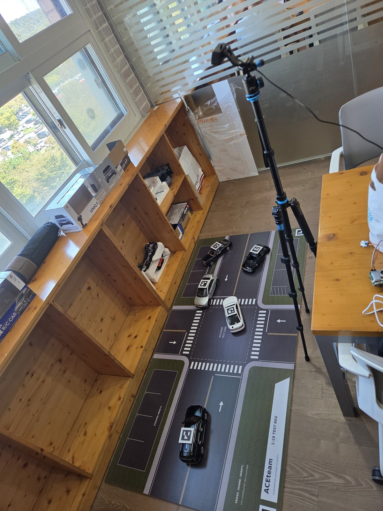

      
1:18 시험 도로에서 차량의 IMU가 충돌을 감지하면, 사고 시각·좌표를 V2V로 주변 차량에 알립니다.

    </td>
    <td width="50%" valign="top">
      
<strong>② 위치·화각 1차 선별</strong>

      
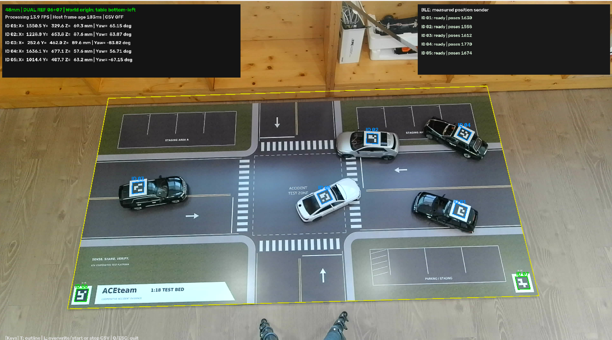

      
ArUco로 추적한 위치·방향을 BLE로 전달합니다. 관측차는 사고 위치와 카메라 화각을 비교해 영상을 분석할 후보를 고릅니다.

    </td>
  </tr>
  <tr>
    <td width="50%" valign="top">
      
<strong>③ AI 영상 2차 선별</strong>

      
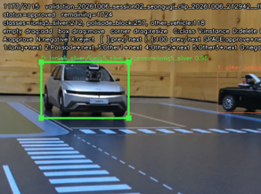

      
YOLOX-Tiny로 영상 속 대상 차종을 검출합니다. 사고 차량이 보이는 영상을 골라 사고 전후 구간을 서버로 전송합니다.

    </td>
    <td width="50%" valign="top">
      
<strong>④ 서버·병합 확인</strong>

      
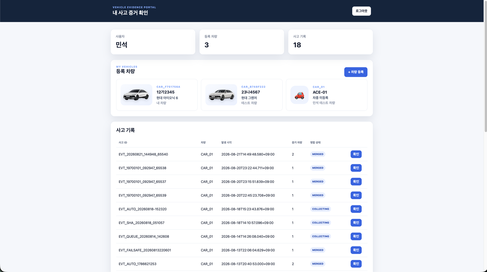 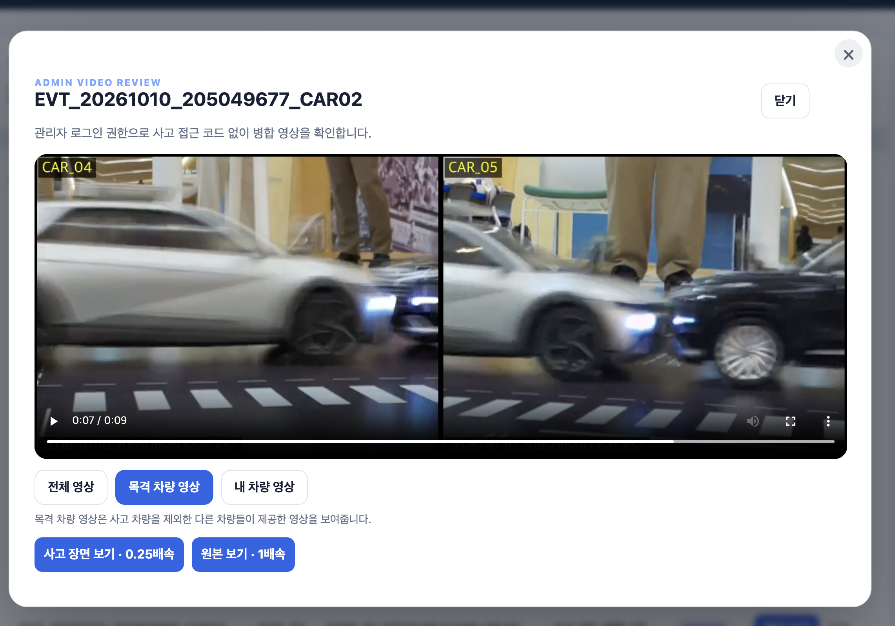

      
사용자 포털에서 자신의 차량 사고를 조회합니다. 서버가 사고 ID와 촬영 시각으로 정렬·병합한 영상에서 여러 시점을 함께 확인합니다.

    </td>
  </tr>
</table>

| 핵심 설계 | 동작과 효과 |
|---|---|
| **필요한 차량만 분석** | 위치·화각 조건을 통과한 관측차에서 YOLOX-Tiny로 대상 차종을 검출해 증거 영상 후보를 좁힙니다. |
| **충돌 전후를 함께 보존** | 사고차와 관측차 모두 사고 전 8초·후 2초를 수집합니다. 사고차는 위치 수신과 관계없이 충돌 감지 즉시 영상 보존을 시작합니다. 주변 차량은 위치·화각을 먼저 판정하고, 사고 후 영상까지 모은 뒤 AI 분석과 영상 생성을 진행합니다. |
| **인터넷 연결 상태에 관계없이 언제 어디서나** | 위치 추정·V2V·차량 내 판정으로 인터넷 없이도 증거를 확보합니다. 영상은 로컬과 영속성 큐에 보관하고, 서버 연결 시 전송합니다. |
| **여러 시점의 증거를 한곳에** | 사고차와 주변 차량의 영상을 사고 ID와 영상 시각으로 연결합니다. 로그인한 사용자는 자신의 차량 사고를 여러 각도의 영상으로 확인합니다. |

## AWS Connected Mobility Lens를 참고한 설계 기조

AWS Well-Architected Framework의 차량 내 처리·데이터 선별·연결 단절 대응·접근 인증 원칙을 설계에 반영했습니다.

| 설계 원칙 | ACE에 적용한 방식 |
|---|---|
| [차량에서 판단](https://docs.aws.amazon.com/wellarchitected/latest/connected-mobility-lens/selection.html) | IMU·위치·AI 판정을 차량에서 수행해 서버 응답 없이 증거 확보 |
| [필요한 데이터만 수집](https://docs.aws.amazon.com/wellarchitected/latest/connected-mobility-lens/data.html) | 사고 전후 구간과 관측차 영상을 선별해 전송·서버 처리 부담 완화 |
| [통신 단절에 대비](https://docs.aws.amazon.com/wellarchitected/latest/connected-mobility-lens/design-principles-rel.html) | 영상·사고 정보를 영속성 큐에 보존하고 서버 연결 시 전송 재시도 |
| [차량·사용자별 접근 인증](https://docs.aws.amazon.com/wellarchitected/latest/connected-mobility-lens/identity-and-access-management.html) | 차량별 API Key로 업로드 인증, 사용자·사고별 권한으로 증거 조회 관리 |

## 장치 안에서는 이렇게 나누어 처리합니다

**프로세스 블록 다이어그램 - systemd 서비스로 작동하므로, 사용자가 프로그램을 하나씩 켜지 않아도 전원이 들어오면 각 장치가 맡은 기능을 자동으로 수행합니다.**

<a href="docs/assets/embedded-process-architecture.png">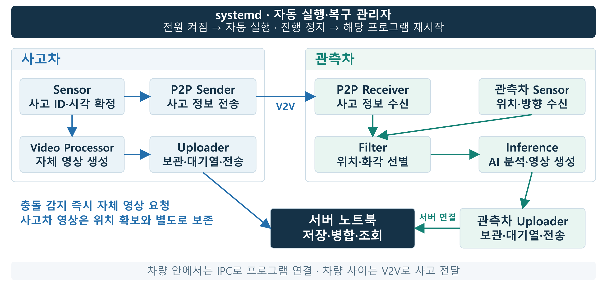</a>

센서·사고 전달·영상 분석·업로드를 각각 독립된 프로세스(실행 중인 프로그램)로 나누고, 같은 차량 안에서는 IPC(프로그램 간 메시지 통신)로 사고 정보와 처리 결과를 주고받습니다. 사고차는 충돌 감지 즉시 자체 영상 보존을 요청하고, 관측차는 위치·화각과 AI 판정을 거쳐 영상을 선별합니다.

**프로세스 내부의 주요 스레드 구성**

| 모듈 | 나누어 처리하는 업무 | 분리한 이유 |
|---|---|---|
| 사고차 Sensor | BLE 위치 수신 / IMU 수신 / 충돌 판정 / IPC 송신 | IPC 재연결 대기가 센서 수신·판정을 막지 않도록 |
| 관측차 Filter | 위치 수신 / 사고 수신 / 위치·화각 판정과 전달 | 다음 단계의 연결을 기다려도 입력을 계속 받도록 |
| 영상 처리 | 카메라 프레임 수신 / 사고 이벤트 수신 / 분석·저장 / 완성 영상 인계 | 분석·인계 중에도 촬영을 계속하도록 |
| Uploader | 영상 접수 / SQLite 대기열 관리 / 서버 전송 | 인터넷 단절 중에도 새 영상을 보관하도록 |

각 프로그램 안에서도 수신과 처리를 나누어 스레드를 분리하였습니다. 공유 데이터와 대기 작업은 뮤텍스·조건변수로 관리합니다.

**systemd는 자동 실행·복구 관리자입니다.** 부팅할 때 프로그램을 시작하고, 실행 상태와 작업 진행을 감시해 멈춘 서비스를 재시작합니다. Uploader는 보관한 영상부터 전송을 이어갑니다. 프로세스별 감시·재시작으로 장애의 영향을 줄여, 각 장치가 같은 역할을 계속 수행하는 임베디드 노드로 동작합니다.

[프로세스 간 메시지](ipc/README.md) · [영상 버퍼와 처리 스레드](ai/README.md) · [전송 재개](uploader/README.md) · [자동 실행 설정](scripts/README.md)

## 2회 선별 구조의 효율성

**관측차 총 5,990대 → 화각 후보 2,839대 → 가림을 반영한 영상 후보 925대.** 도로 시뮬레이션의 차량 수와 배치를 랜덤으로 변경해가며 일반도로·교차로·지하차도·고가도로를 100회 시물레이션 하였습니다.

<a href="docs/measurements/road-simulation/README.md">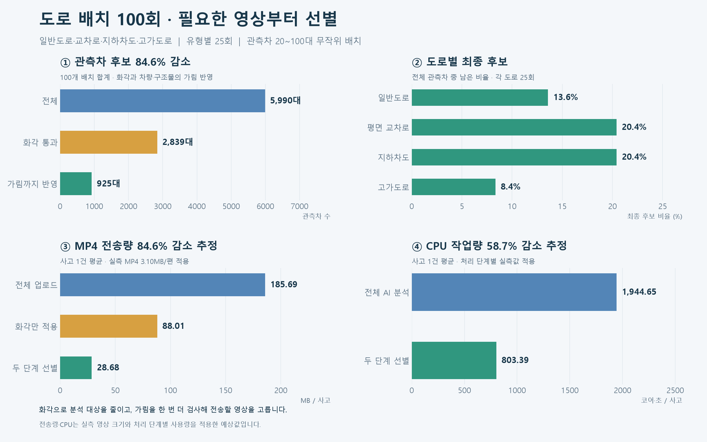</a>

시뮬레이션에서 사고차가 다른 차량이나 도로 구조물에 가리는지까지 계산했습니다. 

**여기에 실제 영상 크기와 처리 단계별 CPU 사용량을 적용하면 MP4 전송량 84.6%, CPU 작업량 58.7% 감소를 예상할 수 있습니다.**

[배치별 결과·계산 근거·재현 방법 →](docs/measurements/road-simulation/README.md)

## 검증 결과

- **통합 동작·복구:** [9조건 27 / 27회 · 영상 81 / 81건 저장 · 단절 영상 12건 복구](docs/measurements/20261008-scenarios/README.md)
- **사고·영상 판정:** [IMU 주행·충돌 22건](docs/measurements/README.md#imu-사고-판정) · [AI 프레임 정답률 98.39% · 검출률·오탐률·Confidence 선정](docs/measurements/ai-evaluation/README.md)
- **통신·시각:** [4만 건 수신율 99.975% · ACK 응답 시간](docs/measurements/20261007-p2p/README.md) · [차량 간 시각 오차](docs/measurements/README.md#차량-간-시각)
- **처리 성능:** [CPU·메모리·통신량·온도](docs/measurements/README.md#처리-단계별-부하) · [영상 생성·큐 인계 평균 6.55초](docs/measurements/README.md#종단-시간)
- **도로 선별 효율:** [100회 배치의 선별량·전송량·CPU 작업량 환산](docs/measurements/road-simulation/README.md)

## 실제 차량으로의 확장성

**시험 장치의 위치 추적·카메라·차량 간 통신을 실제 차량 장치로 바꾸어 연결하는 확장 방안입니다.**

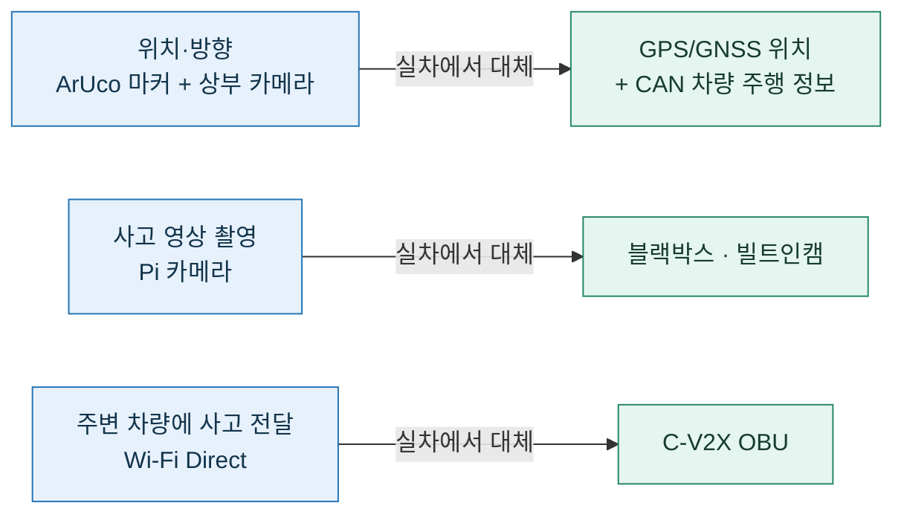

실차에서는 GPS 위치와 CAN으로 얻은 차속·조향각 등의 정보를 기록해 **사고 순간 차량이 어디에 있었고 어느 방향을 보고 있었는지** 계산합니다. 여기에 카메라의 장착 방향과 촬영 시각을 맞추면, 움직이는 관측차도 사고 순간의 위치·방향으로 영상을 선별하는 구조로 확장할 수 있습니다.

블랙박스·빌트인캠 영상은 기존 사고 전후 영상 수집 흐름에 연결합니다.

**표준 기반 차량 간 통신과 실차 확장**

사고 정보 전달에는 다음 표준 기반 메시지 구조와 인코딩 방식을 적용했습니다.

| 적용 항목 | 구현 내용 |
|---|---|
| **ETSI DENM · [TS 103 831](https://www.etsi.org/deliver/etsi_ts/103800_103899/103831/02.01.01_60/ts_103831v020101p.pdf)** | 사고 식별자·발생 시각·위치 등을 담은 사고 메시지 생성·복원 |
| **ETSI BTP-B · [EN 302 636-5-1](https://www.etsi.org/deliver/etsi_en/302600_302699/3026360501/02.02.01_60/en_3026360501v020201p.pdf)** | 4바이트 전송 헤더와 DENM 목적지 포트 2002 적용 |
| **ASN.1 UPER** | 사고 메시지를 바이너리로 인코딩·디코딩 |

현재는 Wi-Fi Direct로 사고 정보를 전달하며, 실차에서는 C-V2X OBU의 SDK에 맞춰 메시지와 송수신 연결부를 연동하는 방식으로 확장할 수 있습니다. **주변 차량 선별 → 사고 전후 영상 보존 → 서버 수집·병합·조회**로 이어지는 핵심 처리 흐름을 재사용합니다.

**제조사별 차종 학습과 차량 정보 연결을 통한 적용 범위 확대**

차종별 학습 데이터와 인식 모델을 확대하고, 차량 ID에 연결된 차종 정보를 영상 선별에 활용할 수 있습니다. 이를 바탕으로 현대·기아 등 제조사의 차량들이 서로 사고 영상을 제공하는 **제조사 기반 협력 증거 확보 서비스**로 확장할 수 있습니다.

[관측차 선별 방식](filter/README.md) · [차량 간 통신 구조](p2p/README.md)

## 주요 문제 해결 내역

<table>
  <tr>
    <td width="33%" align="center" valign="middle">
      <a href="https://github.com/kingwooseok/sensorfusion_bno086_paa5100je">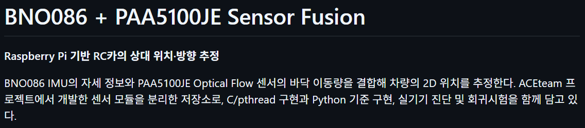</a>
    </td>
    <td width="33%" align="center" valign="middle">
      <a href="https://github.com/raspberrypi/trixie-feedback/issues/102">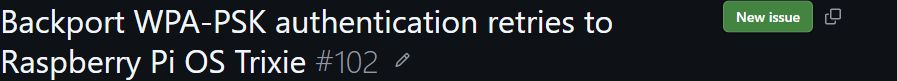</a>
    </td>
    <td width="34%" align="center" valign="middle">
      <a href="https://lore.kernel.org/linux-wireless/20261010-rtl8xxxu-usb-dma-v1-1-e670d9c08fdf@khu.ac.kr/">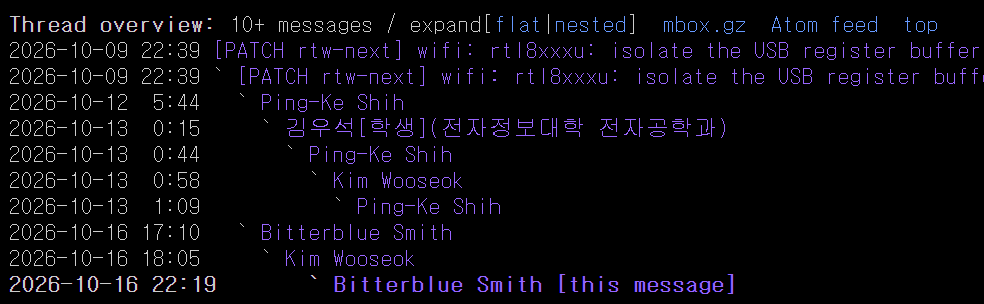</a>
    </td>
  </tr>
  <tr>
    <td valign="top">
      
<strong>센서 융합 위치 추정의 누적 오차</strong>

      
BNO086·PAA5100JE 기반 위치 추정에서 이동 속도에 따른 왕복 오차를 확인했습니다. 중간 기술지원 조언을 반영해 위치·방향 추정을 상부 카메라의 <strong>ArUco 방식으로 전환</strong>하고, 센서 융합 구현과 진단 도구는 별도 저장소에 정리했습니다.

      
<a href="https://github.com/kingwooseok/sensorfusion_bno086_paa5100je">센서 융합 구현·실측 기록</a>

    </td>
    <td valign="top">
      
<strong>Trixie Wi-Fi 자동 재연결 중단</strong>

      
인증 실패 후 새 비밀번호 입력을 기다리며 재연결이 멈추는 문제를 해결하기 위해, 상위 NetworkManager의 인증 재시도 개선을 <strong>Trixie에 백포트</strong>했습니다. 저장된 비밀번호로 재시도·재연결을 검증하고 Raspberry Pi OS에 반영을 제안했습니다.

      
<a href="https://github.com/raspberrypi/trixie-feedback/issues/102">Trixie 이슈 #102</a> · <a href="networkmanager-backport/README.md">백포트·검증 결과</a>

    </td>
    <td valign="top">
      
<strong>rtl8xxxu 무선 드라이버 수신 장애</strong>

      
AP 재시작 후 무선 수신이 복구되지 않는 원인을 USB 레지스터 버퍼와 CPU 상태의 캐시라인 공유 문제로 추적하고, <strong>버퍼를 분리해 수정</strong>했습니다. <code>rtw-next</code> 대상으로 패치를 제출해 메인테이너의 <strong>Acked-by</strong>를 받았습니다.

      
<a href="https://lore.kernel.org/linux-wireless/20261010-rtl8xxxu-usb-dma-v1-1-e670d9c08fdf@khu.ac.kr/">패치 제출</a> · <a href="https://lists.openwall.net/linux-kernel/2026/10/12/282">메인테이너 Acked-by</a>

    </td>
  </tr>
</table>

## 개발과 배포

**Trello로 주간 작업을 정리하고, Slack으로 실험 자료와 이슈를 공유합니다.** Windows의 VS Code에서 VMware Ubuntu에 SSH로 연결해 개발하며, Pi용 실행 파일은 ARM64로 크로스 빌드합니다.

| 12주 개발 백로그 · Trello | 기술 자료와 작업 공유 · Slack |
|:---:|:---:|
| [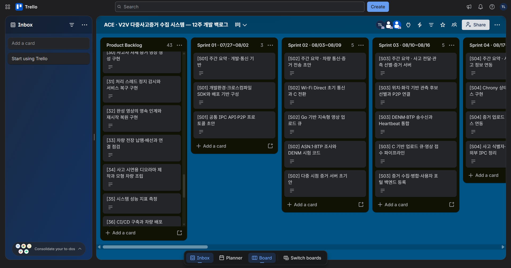](docs/assets/trello.png) | [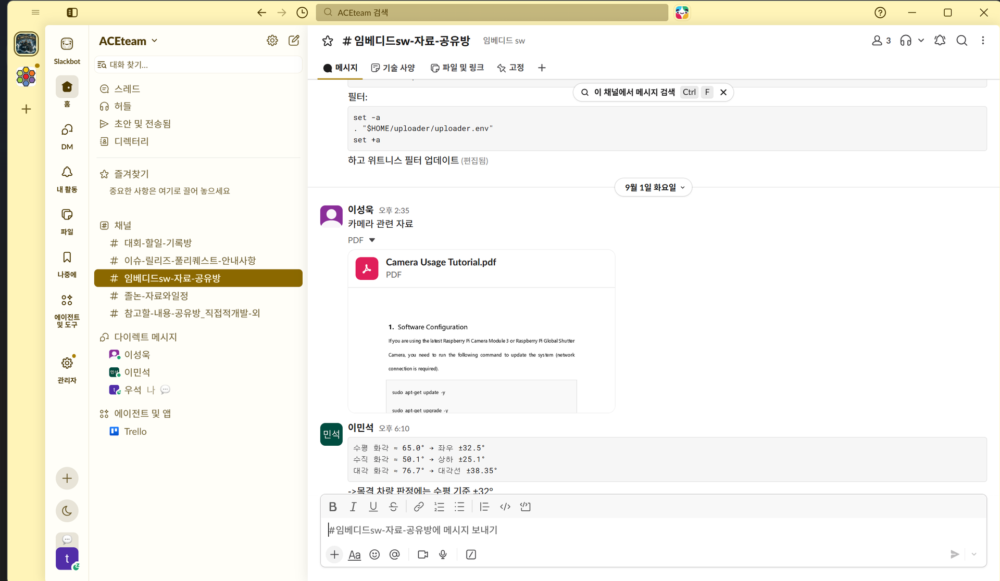](docs/assets/slack.png) |

| 자동 검사 · GitHub Actions CI | 장치 순차 배포 · CD |
|:---:|:---:|
| [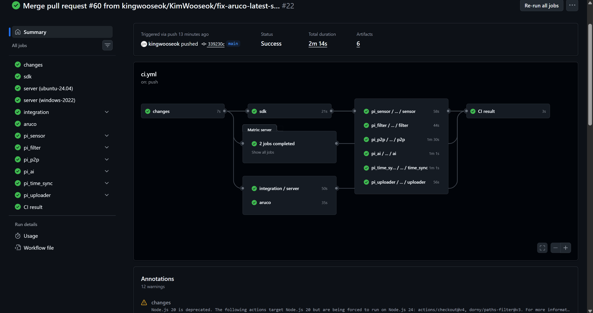](docs/assets/ci.png) | [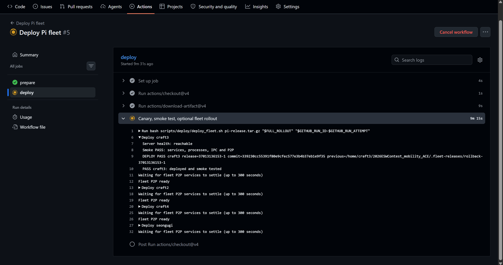](docs/assets/deploy.png) |

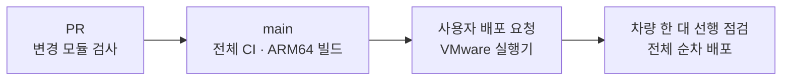

CI는 Pi 6개 모듈 빌드, Ubuntu·Windows 서버 검사, ArUco 오프라인 검사, 실제 FFmpeg 병합을 수행합니다. 배포는 성공한 `main` CI 결과를 VMware 실행기가 받아 진행합니다. **한 대 배포 → 서비스 점검 → 전체 P2P 준비 대기 → 다음 대 배포** 순서로 적용합니다.

[설치·빌드·CI/CD 사용법 →](scripts/README.md) · [워크플로우 실행 기록](https://github.com/kingwooseok/2026ESWContest_mobility_ACE/actions)

## 모듈별 문서

| 시작할 곳 | 내용 |
|---|---|
| [ArUco / BLE](aruco_BLE_(IN_windowsPC)/README.md) | Windows 상부 카메라 추적, 좌표·방향 전송 |
| [Sensor](sensor/README.md) | IMU 사고 판정, 사고 시각과 좌표 연결 |
| [P2P](p2p/README.md) | Wi-Fi Direct, DENM/BTP 사고 전달·수신 ACK·Heartbeat |
| [Filter](filter/README.md) | 사고 좌표와 관측차 방향·화각으로 관측 후보 선택 |
| [AI / Video](ai/README.md) | 카메라 버퍼, YOLOX-Tiny, 사고 전후 영상 생성 |
| [Uploader](uploader/README.md) | 영속성 큐, 재전송, 서버 저장 확인 |
| [Time Sync](time_sync/README.md) | Chrony 상태와 IPC |
| [Server](server/README.md) | 영상 저장·병합, 사용자 포털 |
| [Model Training](model_training/README.md) | 촬영 → Windows 공동 박스 작업 → 학습 → ONNX |
| [IPC](ipc/README.md) | 공통 메시지·통신 API |
| [Scripts](scripts/README.md) · [Toolchain](toolchain/README.md) | 환경 설치, SDK, 빌드·배포 |
| [NetworkManager 백포트](networkmanager-backport/README.md) | 서버 Wi-Fi의 자동 재연결 |

## Copyright and Usage

Copyright (c) 2026 ACE Team. All rights reserved.

This repository and its source code are provided for evaluation and review
purposes only.

No permission is granted to copy, modify, distribute, sublicense, publish,
or use this source code or derivative works for commercial or non-commercial
purposes without prior written permission from the copyright holders.

Third-party components remain subject to their respective licenses.
See [THIRD_PARTY_LICENSE.md](THIRD_PARTY_LICENSE.md) for details.
