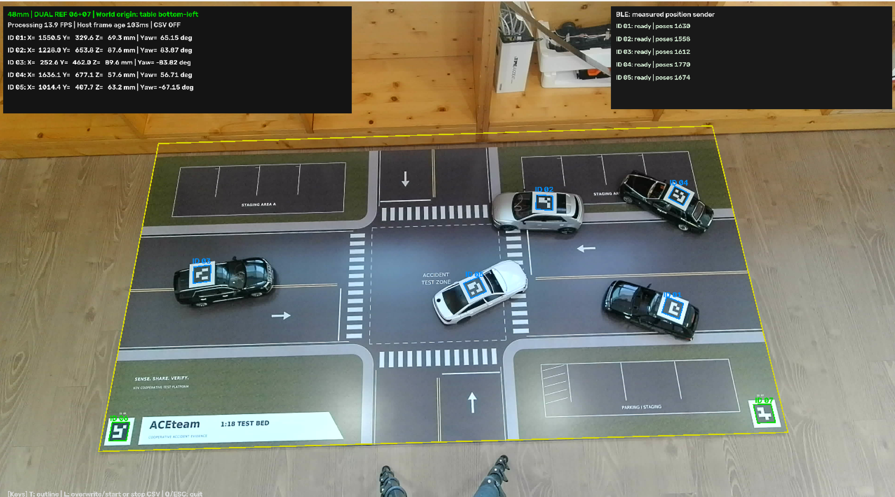

# ArUco 위치 추적 · BLE 송신

**상부 카메라 한 대로 차량의 위치와 방향을 추적하고, 각 Pi에 BLE로 전달합니다.** Windows에서 `01_START_BLE.cmd`를 실행하면 카메라·추적 화면·차량별 송신기가 함께 시작됩니다.




[좌표가 쓰이는 곳](#좌표가-사고-선별로-이어지는-흐름) · [실행](#빠르게-실행하기) · [차량 매칭](#마커와-차량-매칭) · [좌표·방향](#좌표와-전방-설정) · [최초 페어링](#최초-페어링) · [연결 점검](#상태-확인과-문제-해결)

## 좌표가 사고 선별로 이어지는 흐름

| 단계 | 전달하는 정보 | 차량에서 사용하는 곳 |
|---|---|---|
| 기준 설정 | ID06·07로 시험 도로의 원점과 축 설정 | 모든 차량이 같은 좌표계 사용 |
| 차량 추적 | 차량 마커의 위치·높이·전방 방향 계산 | 사고 위치와 관측차의 촬영 방향 결정 |
| BLE 전달 | 마커에 연결된 Pi로 좌표·방향 전송 | [Sensor](../sensor/README.md)가 위치를 받고 [Filter](../filter/README.md)가 관측 후보 선별 |

사고차는 **사고 후 처음 확보한 좌표**를 주변 차량에 알립니다. 관측차는 자신의 위치·카메라 방향과 사고 좌표를 비교해 영상을 분석할 대상을 고릅니다.

## 마커와 차량 매칭

| 마커 | Pi | `vehicle_id` | BLE 광고 이름 |
|---|---|---:|---|
| ID01 | craft2 · 사고차 | 1 | ACE1 |
| ID02 | craft3 | 2 | ACE2 |
| ID03 | craft4 | 3 | ACE3 |
| ID04 | seongugi | 4 | ACE4 |
| ID05 | craft6 | 5 | ACE5 |
| ID06 · ID07 | 경기장 기준 마커 | — | — |

[ble_config.json](ble_config.json)의 `cars`가 마커와 Pi를 연결합니다. 현재는 장치별 Bluetooth `address`를 사용합니다. Pi를 바꾸면 주소를 갱신하고, 사용하지 않는 차량은 `enabled: false`로 설정합니다. 주소 대신 `name`으로 검색할 수도 있습니다.

## 좌표와 전방 설정

**테스트베드 왼쪽 아래가 원점입니다. +Y가 0°, +X가 90°이며, 마커의 +Y를 차량·관찰 카메라 전방과 맞춥니다.**

| 맞추는 항목 | 설정 위치 |
|---|---|
| 카메라 번호 | `tracking_config.json` → `camera_index` (현재 1) |
| 경기장 크기 · ID06/07 실제 중심과 방향 | `tracking_config.json` → `table_size_mm`, `reference_markers` |
| 마커와 차량 전방 관계 | `ble_config.json` → `forward_axis_marker: [0, 1, 0]` |
| 전송 기준점 | `target_offset_marker_mm` — 기본값은 마커 중심 |
| 추가 방향 보정 | `heading_offset_deg` |

마커 검은 영역은 **48mm**, 판 외경은 70mm입니다. 좌표는 차량 높이를 반영한 3D 자세에서 계산하며, ID06/07을 실시간 기준으로 사용합니다. 화면과 BLE는 같은 `Heading`을 사용합니다.

<details>
<summary><b>시각·좌표 기록과 Pi의 사고 위치 선택</b></summary>

Windows는 **카메라에서 프레임을 읽은 시각**을 기록합니다. BLE `CLOCK`으로 Windows와 Pi의 시계 차이를 계산해 Pi 기준 시각으로 전송합니다. 300ms 이상 지난 패킷·중복·역순 패킷은 폐기하고, 차량마다 가장 최근 좌표 한 개를 송신 대기열에 둡니다.

사고 위치 선택은 [Pi 센서 모듈](../sensor/README.md)이 담당합니다. 사고차는 **사고 후 처음 확보한 좌표**를 사고 위치로 사용해 주변 차량에 전달합니다.

CSV의 `Heading_deg`는 차량 전방을 기준으로 실제 송신한 방향입니다. `Yaw_deg`는 마커 +X를 기준으로 한 반시계 각도입니다. 송신기 재실행에 필요한 세션·순번은 `ble_sequence_state.json`에 자동 저장합니다.

</details>

## 빠르게 실행하기

1. Pi를 켭니다. 설치된 `sensor@accident` 또는 `sensor@witness` 서비스가 BLE 수신기를 시작합니다.
2. Windows의 이 폴더에서 **`01_START_BLE.cmd`**를 실행합니다.
3. 추적 화면의 좌표·방향과 BLE `ready`, `poses` 증가를 확인합니다.

<details>
<summary><b>처음 한 번 설치 · 명령으로 실행</b></summary>

Windows Python에 필요한 패키지를 설치합니다. 명령은 이 폴더에서 실행합니다.

```powershell
python -m pip install numpy opencv-contrib-python
python -m pip install -r requirements_ble.txt
python ./track_aruco_4k.py --ble --ble-config ./ble_config.json
```

실행 파일·JSON 설정·`camera_calibration_4k.npz`를 같은 폴더에 둡니다. **`03_CHECK_SETUP.cmd`**로 모듈과 설정, 보정 파일을 한 번에 점검할 수 있습니다.

</details>

| 키 | 동작 |
|---|---|
| `Q` · `Esc` | 종료 |
| `T` | 경기장 외곽선 표시 전환 |
| `L` | CSV 기록 시작·종료 — 새 기록 시작 시 `marker_coordinates_log.csv` 덮어쓰기 |

CSV 기록 여부와 관계없이 BLE 송신은 계속 동작합니다.

## 최초 페어링

Pi와 노트북을 처음 연결할 때 한 번 등록합니다. 이후에는 송신기가 차량별 연결과 재연결을 관리합니다.

<details>
<summary><b>Windows와 Pi의 페어링 · trust 등록</b></summary>

1. Windows에서 `05_PC_BLUETOOTH_ADDRESS.cmd`로 노트북 Bluetooth 주소를 확인합니다.
2. Pi의 센서 수신기에 같은 주소가 `--peer`로 설정돼 있어야 합니다. 기존 노트북 주소는 `88:F4:DA:74:9E:14`입니다.
3. Pi에서 `sudo bluetoothctl`을 열어 다음을 실행합니다.

```text
power on
agent on
default-agent
pairable on
discoverable on
```

4. Windows **설정 → Bluetooth 및 장치 → 장치 추가**에서 해당 Pi를 선택하고 양쪽의 승인 요청을 확인합니다.
5. Pi의 `bluetoothctl`에서 노트북을 신뢰 장치로 등록합니다.

```text
trust 88:F4:DA:74:9E:14
info 88:F4:DA:74:9E:14
```

`Paired: yes`, `Trusted: yes`이면 등록 완료입니다. 노트북을 바꾸면 명령의 주소도 새 주소로 바꿉니다.

</details>

<details>
<summary><b>Pi 수신기를 직접 실행할 때</b></summary>

프로젝트 최상단에서 해당 센서 서비스를 멈춘 뒤 실행합니다. 사고차는 IMU와 충돌 판정 설정도 [센서 README](../sensor/README.md)에 따라 준비합니다.

```bash
# 사고차 craft2
sudo systemctl stop sensor@accident.service
sudo ./test/accident_aruco --vehicle-id 1 --peer 88:F4:DA:74:9E:14
```

```bash
# 관측차 craft3 — 다른 관측차는 위 표의 vehicle_id 사용
sudo systemctl stop sensor@witness.service
sudo ./test/witness_aruco --vehicle-id 2 --peer 88:F4:DA:74:9E:14
```

수동 실행을 종료한 뒤 원래 서비스를 다시 켭니다.

```bash
sudo systemctl start sensor@accident.service   # 사고차
# 관측차에서는 sudo systemctl start sensor@witness.service
```

</details>

## 상태 확인과 문제 해결

| 화면 표시 | 의미 · 다음 행동 |
|---|---|
| `scanning` | Pi 검색 중 — 수신기와 광고 이름 확인 |
| `connecting` | 연결 중 — Pi 전원과 페어링 상태 확인 |
| `synchronizing` | Pi 시계와 시간 보정 중 |
| `ready` · `poses` 증가 | 시간 보정 완료 · Pi가 위치 패킷을 수신 |
| `NO CURRENT VALID POSITION` | 기준 또는 차량 마커 검출 상태 확인 |
| `Cannot open camera 1` | USB 카메라 연결, 다른 앱의 카메라 사용, `camera_index` 확인 |

마커가 가려져도 BLE 연결은 유지됩니다. 유효 좌표가 없는 프레임에는 무효 플래그를 보내고, 다시 검출되면 새 좌표를 전송합니다.

| 실행 도구 | 용도 |
|---|---|
| `02_SCAN_BLE.cmd` | 근처 BLE 광고 이름·주소 검색 |
| `03_CHECK_SETUP.cmd` | Python·OpenCV·설정·보정 파일 점검 |
| `04_PREVIEW_NO_BLE.cmd` | BLE 없이 카메라·위치 추적만 실행 |
| `05_PC_BLUETOOTH_ADDRESS.cmd` | 노트북 Bluetooth 주소 확인 |
| `06_CHECK_BLE_CONNECTION.cmd` | 연결·서비스·특성·MTU 확인 |

## 더 자세히 보기

| 문서 | 내용 |
|---|---|
| [전체 구조](전체구조_이해하기.md) | ChArUco 보정, 좌표 변환, 스레드와 시계 처리 |
| [BLE 패킷 규약](BLE_PROTOCOL.md) | UUID, 패킷 형식, 수신 조건 |
| [BLE 연결 점검](BLE_연결만_확인하는_방법.md) | 연결만 따로 시험하는 절차 |
| [하드웨어 성능 검토](하드웨어_성능검토.md) | 노트북·Pi 검출 성능의 실측 근거 |

[프로젝트 소개](../README.md) · [Pi 센서 모듈](../sensor/README.md)
