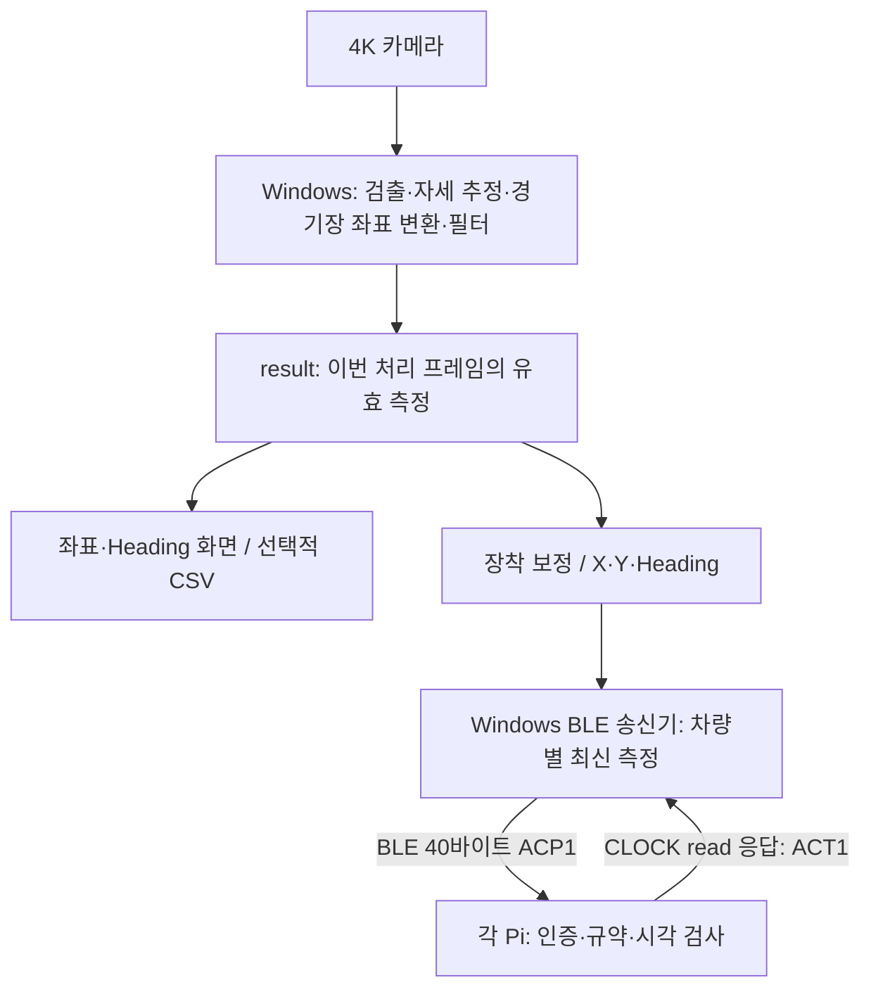

# 카메라에서 차량까지: ArUco BLE 전체 구조 이해하기

이 문서는 프로그램이 어떻게 이어지는지 이해하기 위한 문서입니다. 바로 실행하려면 [README.md](README.md)를 보세요.

## 1. 이 프로젝트에서 Windows와 Pi가 맡는 일

Windows는 4K 카메라로 차량 마커 ID01~05를 관측하고, 기준 마커 ID06/07을 이용해 경기장 기준 위치·방향을 계산한 뒤 각 차량에 전달합니다. 현재 경기장 설정은 1820×960mm입니다.



SSH는 Pi에 명령을 입력하고 로그를 확인하는 관리 연결입니다. 좌표는 Windows 송신기에서 실행 중인 Pi 수신기로 BLE를 통해 전달합니다.

Windows의 위치 전달은 BLE를 사용하고, 차량의 서버·P2P 통신은 Wi-Fi를 사용합니다.

## 2. 실행 파일과 모듈

`01_START_BLE.cmd`가 Python 프로그램 하나를 시작합니다. 그 Python 프로그램이 다른 파일에 있는 함수를 불러 씁니다. 이것이 Python의 `import`입니다.

| 파일 | 맡은 역할 |
|---|---|
| `01_START_BLE.cmd` | 올바른 폴더에서 추적기를 BLE 옵션과 함께 실행 |
| `track_aruco_4k.py` | 카메라 입력, 마커 검출, 기준 좌표 변환, 자세 필터, 화면·CSV, 송신 함수 호출 |
| `tracking_ble_bridge.py` | 추적 결과에서 송신할 위치·방향을 꺼내 장착 보정 |
| `aruco_ble_sender.py` | Pi 검색, 연결, 시간 교환, 최신 값 보관, 전송·재연결 |
| `aruco_ble_protocol.py` | 규약에 맞춰 숫자를 바이트로 포장/해석하고 범위·시간 검사 |
| `tracking_config.json` | 카메라 번호, 기준 마커 배치, 경기장 크기, 필터·품질 설정 |
| `ble_config.json` | 차량 매칭, 장착 보정, 송신 빈도·시간 제한 |
| `camera_calibration_4k.npz` | 카메라 내부 파라미터 K와 렌즈 왜곡 D |
| Pi의 `witness_aruco` / `accident_aruco` | BLE 수신과 기존 차량 프로그램 연결 |

`.cmd`는 실행 명령을 모아둔 파일이고, `.py`는 Python 코드, `.json`은 설정, `.npz`는 NumPy 수치 데이터입니다. 설정을 편집해도 이미 실행 중인 프로그램이 자동으로 다시 읽지는 않으므로 다음 실행 때 반영합니다.

## 3. 화면에 보이는 값이 송신기로 넘어가는 지점

추적기의 핵심 연결은 다음과 같습니다.

```python
result = engine.process(observations, capture_mono)

if sender is not None:
    publish_tracking_result(
        sender, result, sequence,
        round(capture_mono * 1_000_000_000), mounts
    )
```

`observations`는 검출한 마커 ID와 이미지 모서리 좌표입니다. `engine.process()`는 자세와 경기장 좌표를 계산하고 필터를 적용해 `result`라는 Python 딕셔너리에 넣습니다. 딕셔너리는 이름이나 번호로 값을 찾는 자료 구조입니다.

```python
item = result["vehicles"][1]    # 유효하게 추정된 ID01이 있을 때
position = item["xyz_mm"]      # 경기장 기준 X, Y, Z
rotation = item["pose"].R      # 필터를 거친 3차원 회전행렬
```

`result["vehicles"]`에는 이번 처리 프레임에서 유효한 차량만 들어갑니다. 해당 ID가 없을 수 있으므로 실제 코드는 있는 항목을 순회합니다.

측정 결과 `result`는 화면·선택적 CSV 기록·송신 함수로 각각 전달됩니다.

장착 보정 후에는 다음과 같은 작은 딕셔너리가 만들어집니다. 수치는 설명용입니다.

```python
{
    1: {"x_mm": 123.4, "y_mm": 567.8, "heading_deg": 90.0}
}
```

송신기가 차량1 연결을 골라 차량 ID·시간·순번·유효 여부를 붙여 전송합니다. ID06/07은 기준 좌표 계산에 사용하며 차량 위치 패킷 대상으로 보내지 않습니다.

## 4. 카메라 캘리브레이션·마커 검출·기준 배치

먼저 같은 점도 어느 기준으로 표현하느냐에 따라 숫자가 달라집니다.

| 좌표계 | 기준과 단위 | 현재 코드에서 쓰는 곳 |
|---|---|---|
| 영상 좌표 u/v | 영상 왼쪽 위에서 오른쪽·아래 방향, 픽셀 | 검출 모서리 observations |
| 카메라 좌표 | 카메라 기준 3차원 위치, 현재 PnP 입력에 따라 m | 마커의 camera_pose |
| 경기장 좌표 | 물리적 왼쪽 아래에서 +X 오른쪽·+Y 위쪽, 높이 Z | world pose, 화면 xyz_mm |
| 마커 로컬 좌표 | 마커에 붙어서 함께 회전하는 축 | 장착 위치 차이·전방축 설정 |

영상의 픽셀 X/Y는 카메라와 기준 마커의 자세를 이용해 경기장 좌표로 변환합니다.

### 카메라 캘리브레이션: 원리와 실제 보정값

카메라는 공간의 점을 영상의 픽셀로 투영합니다. 렌즈 왜곡이 없는 기본 모델에서는 카메라 좌표 (Xc,Yc,Zc)를 다음처럼 픽셀 (u,v)로 바꿉니다.

```text
u = fx × (Xc / Zc) + cx
v = fy × (Yc / Zc) + cy

K = [ fx   0  cx ]
    [  0  fy  cy ]
    [  0   0   1 ]
```

fx·fy는 픽셀 단위 초점거리이고 cx·cy는 주점입니다. 픽셀 좌표만으로 거리까지 정해지지는 않으므로, 자세 추정에는 실제 크기를 아는 보드나 마커가 함께 필요합니다. 렌즈의 방사·접선 왜곡은 D로 모델링합니다. [OpenCV 카메라 모델](https://docs.opencv.org/4.13.0/d9/d0c/group__calib3d.html)

웹캠은 Philips SPL6418 고정 초점 모델을 사용합니다. 캘리브레이션할 때와 추적할 때 렌즈·영상 크롭·줌·해상도 조건을 맞춥니다. 같은 시야를 확대·축소한 영상에는 K의 픽셀 관련 값도 비율에 맞춰 조정합니다.

추적기는 3840×2160 입력으로 마커를 검출하며, 미리보기는 1280×720으로 표시합니다.

#### ChArUco 보정에 사용한 보드와 계산 순서

현재 보정 스크립트의 보드 정의는 다음과 같습니다.

| 항목 | 값 |
|---|---|
| 체커보드 칸 수 | 가로 7 × 세로 5 |
| 내부 교차점 | 최대 24개 |
| 사각형 한 칸 길이 | 40mm |
| 보드 안 ArUco 마커 길이 | 30mm |
| 마커 사전 | DICT_4X4_50 |

보정에는 보드의 실제 30mm 마커 길이를, 차량 추적에는 48mm 마커 길이를 사용합니다.

1. 보드를 서로 다른 위치·기울기·거리에서 촬영합니다. 영상 중앙뿐 아니라 가장자리에도 관측점이 분포하도록 합니다.
2. `CharucoDetector.detectBoard()`로 보드의 내부 교차점 픽셀 좌표와 ID를 찾습니다.
3. `board.matchImagePoints()`로 각 교차점의 알려진 보드 좌표와 영상 좌표를 대응시킵니다.
4. `cv2.calibrateCamera()`가 여러 영상에 공통인 K/D와 영상별 보드 자세를 함께 추정합니다.
5. `cv2.projectPoints()`로 보드 점을 다시 영상에 투영해 오차를 계산하고 결과를 NPZ에 저장합니다.

촬영 기록은 33장입니다. 보정 사진에는 화면 여러 위치와 기울기의 보드를 포함하고 인쇄 크기·평탄도·선명도를 확인합니다.

#### 현재 NPZ에서 확인한 값

`camera_calibration_4k.npz`에 저장된 K/D를 표시 자릿수를 줄여 적었습니다. 실행 시에는 파일에 저장된 정밀도를 사용합니다.

```text
image_size = (3840, 2160)

K = [ 2256.198489     0.000000  1903.659170 ]
    [    0.000000  2253.782857  1114.211716 ]
    [    0.000000     0.000000     1.000000 ]

D = [k1, k2, p1, p2, k3]
  = [0.004393238, -0.011707256,
     -0.001469048, 0.000626274, -0.000962333]

rms_error = 0.6111665245 pixels
```

fx·fy는 픽셀 단위 초점거리, (cx,cy)는 주점입니다. p1·p2는 접선 왜곡, k1·k2·k3는 방사 왜곡 계수입니다.

여기서 RMS는 보정에 사용한 관측점과 재투영점 사이의 픽셀 거리 오차입니다.

```text
RMS = sqrt(모든 점의 [(u - u예측)² + (v - v예측)²] 합 / 전체 점 수)
```

약 0.6112px는 보정 관측점에 대한 재투영 RMS입니다. 실제 좌표 오차는 경기장 여러 위치·높이·방향에서 알려진 치수와 측정값을 비교해 확인합니다.

#### 보정값 저장과 추적기의 사용

01번이 기본으로 읽는 파일은 [camera_calibration_4k.npz](camera_calibration_4k.npz)입니다.

| 저장 키 | 내용 |
|---|---|
| `camera_matrix` | K, 3×3 행렬 |
| `dist_coeffs` | D, 1×5 왜곡 계수 |
| `image_size` | 보정 영상 크기 (3840,2160) |
| `rms_error` | 보정 데이터의 재투영 RMS |

추적기는 시작할 때 이 파일에서 K/D를 읽습니다. 매 프레임마다 K/D와 검출 모서리로 마커 위치 t와 회전 R을 계산합니다.

원본 영상에서 검출한 모서리와 K/D를 PnP에 함께 넘깁니다. 자세 계산과 `projectPoints()`에서 렌즈 왜곡 모델을 적용합니다.

### 마커 검출과 흰 여백(Quiet Zone)

검출은 영상에서 사각형 후보를 찾고, 후보 내부 패턴을 사전과 비교해 ID와 방향을 결정하는 과정입니다. 현재 코드는 회색조 변환, ArUco 검출, 서브픽셀 모서리 보정을 사용합니다.

검은 테두리 바로 바깥이 어두운 차체나 배경이면 테두리와 배경이 붙어 보이며 후보 검출이 어려워질 수 있습니다. 밝은 여백은 테두리를 주변과 구분하는 데 도움이 됩니다. 촬영 환경에서는 반사·그림자·가림을 줄이고 마커를 선명하게 배치합니다.

이 프로젝트의 도안 규격은 다음과 같습니다.

| 항목 | 설계 치수 |
|---|---|
| 판 외경·칼선 경로 | 70 × 70mm |
| 검은 ArUco 외곽 | 48 × 48mm |
| 중앙 배치 시 사방 여백 | (70−48)/2 = 11mm |
| 도안 구성 | 칼선·화이트·마커 인쇄 레이어 분리 |

PnP에는 검은 마커 외곽의 48mm를 변 길이로 넣습니다.

픽셀 크기는 해상도뿐 아니라 초점거리·카메라와의 거리·기울기에 따라 달라집니다. 현재 fx≈2256px에서 마커가 카메라와 정면으로 마주보고 깊이가 1.5m인 단순 근사라면 `픽셀 길이 ≈ fx × 실제 길이 / 깊이`이므로, 48mm는 약 72px, 11mm는 약 17px입니다.

### 기준 마커 배치: 경기장이 어디에 있는가

ID06/07의 실제 위치와 방향을 알려주면 그 마커의 모서리를 경기장 좌표로 표현할 수 있습니다. 추적기는 영상에서 보이는 모서리와 알려준 경기장 모서리를 대응시켜 **경기장→카메라 변환**을 계산합니다.

원점은 경기장의 물리적 왼쪽 아래입니다. +X는 오른쪽, +Y는 경기장 평면의 위쪽이며 높이는 Z로 표현합니다.

현재 `tracking_config.json`에는 다음 값이 들어 있습니다.

| 값 | 현재 파일 내용 |
|---|---|
| 경기장 크기 | 1820 × 960mm |
| ID06 중심 | [46, 50, 0]mm |
| ID07 중심 | [1770, 50, 0]mm |
| 두 기준 마커 yaw | 각각 0° |

70×70mm 판의 바깥쪽 여백을 기준으로 ID06은 왼쪽 11mm·아래 15mm, ID07은 오른쪽 15mm·아래 15mm 안쪽에 배치합니다. 마커가 판 중앙에 있으므로 ID06 중심은 [11+35, 15+35, 0] = [46, 50, 0]mm, ID07 중심은 [1820−15−35, 15+35, 0] = [1770, 50, 0]mm입니다. 두 중심의 간격은 1724mm이며 원점은 경기장 왼쪽 아래 모서리로 유지합니다.

## 5. 3차원으로 계산하고 X/Y만 보내는 이유

PnP는 알려진 3차원 점과 영상의 2차원 점으로 자세를 추정합니다. 현재 코드는 검은 마커 한 변을 0.048m로 정의하고, 중심을 기준으로 네 모서리 좌표와 영상에서 검출한 네 모서리를 대응시킵니다.

```text
마커 로컬 모서리 좌표, 단위 m:
(-0.024, +0.024, 0)
(+0.024, +0.024, 0)
(+0.024, -0.024, 0)
(-0.024, -0.024, 0)

입력: 3D 모서리 + 관측 픽셀 모서리 + K + D
출력: rvec, tvec
R = cv2.Rodrigues(rvec)[0]
```

tvec는 마커 중심의 카메라 좌표입니다. rvec는 축·각도 방식의 회전벡터이며, 벡터 방향이 회전축이고 길이가 회전각(라디안)입니다. Rodrigues 변환으로 3×3 회전행렬 R을 얻습니다.

현재 정사각형 차량 마커에는 `solvePnPGeneric(..., SOLVEPNP_IPPE_SQUARE)`를 사용합니다. 평면 자세의 후보들을 비교하고 연속 유효 관측에서는 이전 자세도 후보 선택에 활용하며, 현재 모서리 관측으로 LM 보정을 시도합니다. 재투영 오차와 유효성 검사를 통과한 자세를 경기장 기준으로 변환합니다. 차량 높이를 강제로 0에 고정하지 않습니다. [OpenCV 자세 추정](https://docs.opencv.org/4.13.0/d9/d0c/group__calib3d.html)

계산 관계를 기호로 쓰면 다음과 같습니다.

```text
R_cm, t_cm: 마커 좌표 → 카메라 좌표
R_cw, t_cw: 경기장 좌표 → 카메라 좌표

R_wm = R_cw.T @ R_cm
t_wm = R_cw.T @ (t_cm - t_cw)
```

`.T`는 전치, `@`는 행렬 곱입니다. 회전행렬의 전치는 역회전이므로 카메라 기준 자세를 경기장 기준으로 돌려놓는 식입니다. 코드 내부 위치 계산은 m 단위이고 `xyz_mm`를 만들 때 1000을 곱해 mm로 바꿉니다.

회전과 이동을 하나의 4×4 동차변환 행렬로 묶으면 같은 계산을 다음처럼 표현할 수 있습니다.

```text
T = [ R  t ]
    [ 0  1 ]

T_wm = inverse(T_cw) @ T_cm
```

T_cw는 현재 프레임의 ID06을 주 기준으로 계산하고 ID07을 보조 보정에 사용합니다. 07 보정이 맞지 않으면 06으로 계산을 이어가며, 06을 사용할 수 없으면 현재 07로 추정합니다. 원점은 경기장 왼쪽 아래 모서리입니다.

화면의 경기장 외곽선은 `cv2.projectPoints()`에 경기장 네 모서리, 경기장→카메라 자세, K/D를 넣어 영상 위에 그립니다.

차량의 높이를 포함한 3차원 자세를 추정한 뒤 X/Y와 방향을 추출합니다.

마커 변 길이 48mm는 추정 거리의 척도로 사용합니다.

## 6. 마커 중심과 차량 기준점, 화면·전송 Heading

현재는 모든 차량의 장착 위치 보정이 [0,0,0]입니다. 따라서 X/Y는 마커 중심입니다. 차량 중앙이나 관찰 카메라 위치를 보내려면 그 기준점이 마커 중심에서 어디에 있는지 설정해야 합니다.

```python
target = marker_center_mm + R_world_marker @ offset_marker_mm
forward = R_world_marker @ forward_axis_marker
heading = degrees(atan2(forward[0], forward[1])) % 360
```

위치 차이와 전방축은 **마커의 로컬 축**으로 설정합니다. 회전행렬 R을 곱하면 차량이 회전할 때 장착 위치와 방향도 함께 회전합니다.

현재 차량 5대는 `forward_axis_marker: [0,1,0]`으로 **마커 +Y를 차량·관찰 카메라의 전방**으로 사용합니다. 마커 +Y 방향을 실제 전방에 맞춰 붙입니다. 기울어진 광축도 `[x,y,z]` 벡터로 설정할 수 있으며, 전체 3D 회전행렬로 경기장 방향에 투영합니다. 이 설정은 기존 `heading_offset_deg`보다 우선합니다.

| 차량·관찰 카메라가 바라보는 경기장 방향 | 화면·송신 Heading |
|---|---:|
| 위쪽 +Y | 0° |
| 오른쪽 +X | 90° |
| 아래쪽 −Y | 180° |
| 왼쪽 −X | 270° |

화면과 BLE는 같은 변환 결과를 사용합니다. BLE를 끈 미리보기에서도 `ble_config.json`의 장착 방향을 읽습니다. CSV의 `Yaw_deg`는 기존 마커 +X 기준 반시계 각도로 유지하고, 마지막 `Heading_deg` 열에 실제 송신 방향을 추가합니다.

X/Y는 패킷에서 정수 mm로 반올림하고 Heading은 0.01° 단위 정수로 표현합니다. 기본 설정에서는 화면의 마커 중심 좌표를 반올림하여 보냅니다. 장착 위치 보정을 설정하면 해당 차량 기준점의 좌표를 보냅니다.

## 7. 두 기준 마커와 떨림 필터

| 이번 처리 프레임의 기준 마커 | 현재 동작 |
|---|---|
| 06 유효, 07 보정 성공 | 06:07 비중 2:1로 경기장→카메라 자세 보정 |
| 06 유효, 07 누락·보정 실패 | 현재 프레임의 06으로 계산 유지 |
| 06 누락·불량, 07 유효 | 현재 프레임의 07로 같은 경기장 좌표계 계산 |
| 두 기준 모두 사용 불가 | 기준 자세와 차량 추정 상태 초기화 |

06의 모서리에 07보다 두 배의 비중을 주어 보정하고, 보정된 자세에서 각 마커의 재투영 오차를 따로 검사합니다. 07의 오차가 허용값을 넘으면 보정을 적용하지 않고 현재 06의 추정값을 사용합니다.

차량과 기준 자세에는 적응형 저역 통과 필터를 적용합니다. 연속된 유효 관측에서 떨림을 줄이고, 변화가 클수록 새 측정을 빠르게 반영합니다. 내부 velocity 값은 이 필터 반응 속도를 조절합니다.

회전은 회전행렬 사이의 상대 회전을 보간합니다. 회전벡터 성분을 단순 평균해 ±180° 부근에서 뒤집히는 문제를 피하도록 구현되어 있습니다.

차량 검출이나 유효 추정에 실패하면 해당 차량의 필터와 이전 후보 상태를 초기화합니다. 기준 상실이나 0.2초를 넘는 관측 간격도 상태를 초기화합니다. 재검출 시 새 관측부터 계산합니다.

`tracking_config.json`의 `reference_max_reprojection_rms_px`는 기준 마커 06·07의 허용값 6px, `max_reprojection_rms_px`는 차량 마커의 허용값 2px입니다. 재투영 RMS는 추정한 모서리를 영상에 투영한 위치와 검출 모서리의 차이를 픽셀 단위로 계산합니다. 설정 변경은 추적 프로그램을 다시 실행하면 적용됩니다.

## 8. 카메라·계산·BLE의 실행 흐름

한 Python 프로그램 안에 크게 세 실행 흐름이 있습니다. 스레드는 같은 프로그램 내부에서 별도로 진행하는 작업 흐름입니다.

| 실행 흐름 | 하는 일 |
|---|---|
| 카메라 스레드 | 카메라를 계속 읽고 최신 영상 하나를 보관 |
| 주 처리 스레드 | 최신 영상 선택 → OpenCV → 좌표·필터 → 송신 전달 → 화면·선택적 CSV |
| BLE 스레드 | asyncio로 검색 1개와 차량별 연결 작업 최대 5개 관리 |

asyncio는 통신 응답 대기 중 다른 차량의 작업을 진행합니다. 차량별 연결·시계 보정·전송 작업이 독립적으로 진행되며 Windows의 Bluetooth 어댑터를 함께 사용합니다.

카메라가 프레임 100을 넘긴 뒤 계산하는 동안 101·102를 읽었다면 다음 계산은 최신 102를 선택합니다.

BLE도 차량별 **대기 슬롯 하나**를 둡니다. 새 측정이 들어오면 대기 값을 교체합니다. 이미 시작한 write는 응답을 기다리고, 그동안 다음 최신 측정 하나를 보관합니다.

## 9. 처리 빈도와 지연

- 카메라 FPS: 카메라가 영상을 내놓는 빈도.
- 처리 FPS: 검출·좌표·화면 등 처리 루프가 실제 완료하는 빈도.
- 송신 Hz: 차량별 패킷 쓰기 빈도. write 시도와 GATT 응답 성공 횟수를 각각 기록합니다.
- 측정 나이: 지금 쓰려는 관측이 얼마나 전에 얻어진 것인지.
- 재검출 지연: 가려진 마커가 다시 보인 뒤 첫 유효 측정이 Pi에 채택되기까지 걸린 시간.

`max_rate_hz: 30`은 차량당 송신 상한입니다. 처리 루프가 12fps라면 서로 다른 측정도 초당 최대 12개이며, 송신기는 각 측정의 원래 촬영 시각을 유지합니다.

전체 지연에는 카메라·드라이버 버퍼, 자세 계산, 송신 대기, BLE 쓰기와 Pi 수신 처리가 포함됩니다.

## 10. BLE 연결에 사용하는 용어

| 용어 | 이 프로젝트에서의 뜻 |
|---|---|
| BLE | 좌표를 전달하는 Bluetooth Low Energy 통신 |
| Central / GATT Client | Pi를 찾아 연결하고 읽기·쓰기를 요청하는 Windows |
| Peripheral / GATT Server | 광고와 CLOCK/POSE 항목을 제공하는 Pi |
| 광고 이름 ACE1 | 검색할 때 찾는 장치 이름 |
| BLE 주소 | 실제 무선 장치를 구분하는 주소 |
| vehicle_id | 응용 프로그램이 정한 차량 번호 |
| UUID | 서비스나 데이터 항목의 종류를 구분하는 식별자 |
| 페어링 | 통신 상대와 인증 정보를 교환하는 등록 |
| trust | Pi가 노트북을 신뢰하도록 하는 로컬 설정 |
| peer | 실제 수신 프로그램이 허용하는 노트북 BLE 주소 |
| GATT write with response | 항목에 데이터를 쓰고 그 요청의 응답을 기다리는 방식 |
| ATT MTU | 한 ATT 메시지에 들어갈 수 있는 최대 크기 |
| IPC | 같은 Pi 안의 프로그램 사이에서 데이터를 전달하는 통로 |

UUID는 데이터 종류를 표시하므로 Pi 다섯 대가 같은 UUID를 사용합니다. 개별 BLE 연결이 어느 Pi인지 구분하고, 패킷의 vehicle_id를 Pi 자신의 번호와 대조합니다.

Windows는 이름/주소에 대응하는 설정의 vehicle_id를 패킷에 넣습니다. Pi 수신기는 자신의 vehicle_id와 일치하는 패킷을 채택합니다. 부착 마커·Pi 실행 ID·PC 설정을 같은 번호로 맞춥니다.

송신기는 MTU를 검사하고 CLOCK/POSE UUID를 사용합니다. `06_CHECK_BLE_CONNECTION.cmd`로 서비스·특성 목록과 MTU를 확인할 수 있습니다.

최초 페어링으로 장치를 등록한 뒤 Pi 수신기를 실행하면 CLOCK/POSE 서비스를 제공합니다. Windows는 등록된 차량의 연결·재연결을 관리합니다. 차량별 연결 작업은 어댑터의 무선 자원을 함께 사용합니다. [Bleak 연결 설명](https://bleak.readthedocs.io/en/latest/api/client.html)

## 11. 숫자가 무선 패킷이 되는 과정

Pi에는 아래 두 데이터 항목이 있습니다.

| 항목 | 방향·크기 | 용도 |
|---|---|---|
| CLOCK / ACT1 | Pi → PC read 응답, 20바이트 | Pi 시각과 세션 확인 |
| POSE / ACP1 | PC → Pi write, 40바이트 | 위치·방향·관측 시각 전달 |

위치 패킷에는 magic(형식 식별 문자), 차량 ID, 유효 플래그, epoch, sequence, 환산 관측 시각, X/Y, Heading, 예약 필드가 들어갑니다. Python `struct.pack`이 이를 합의된 순서와 바이트 크기로 만듭니다. Pi는 같은 약속대로 해석합니다.

영상은 Windows에서 처리하고 차량에는 이 수치 패킷을 보냅니다. 5대에 각각 초당 30회 보내면 위치 본문은 `40 × 30 × 5 = 6,000바이트/초`입니다. 무선 구간에서는 이 본문에 BLE 헤더·응답·CLOCK 교환이 더해집니다.

40바이트 본문에 ATT 쓰기 헤더 3바이트가 필요하므로 MTU는 최소 43이어야 합니다. 현재 수신기는 잘라 보내는 응용 분할이나 prepare/reliable write를 지원하지 않습니다. 송신기가 연결별 MTU를 검사합니다. 바이트 표와 정확한 UUID는 [BLE_PROTOCOL.md](BLE_PROTOCOL.md)에 있습니다.

송신기의 poses와 sent_lost는 GATT write 응답 횟수입니다. 패킷 채택·거절과 후속 IPC 전달 상태는 Pi 수신 로그에서 확인합니다.

## 12. Pi가 서버와 NTP 동기화돼 있어도 CLOCK가 필요한 이유

NTP는 시스템 날짜·시각을 맞춥니다. BLE 규약은 측정 나이를 계산할 때 monotonic 시계를 사용하고, 장치마다 다른 기준점을 CLOCK 교환으로 환산합니다. [Python 시간 함수](https://docs.python.org/3/library/time.html#time.monotonic)

Windows는 차량마다 CLOCK를 읽으며 읽기 시작·종료 시각을 기록합니다.

```text
offset_ns = Pi가 응답에 넣은 monotonic_ns
            - PC에서 read가 완료된 monotonic_ns
            - 1,000,000

capture_pi_ns = 원래 프레임의 PC monotonic_ns + offset_ns
```

초기에는 5회, 이후 약 10초마다 3회 읽습니다. 같은 epoch의 응답 중 RTT가 100ms 이하이고 가장 짧은 표본을 선택합니다. 위 식은 응답 지연과 1ms 여유를 반영하여 촬영 시각을 보수적으로 환산합니다. 이후 주기적인 CLOCK 읽기로 두 시계의 차이를 갱신합니다.

추적기는 `VideoCapture.read()`가 끝난 직후 `time.monotonic()`을 기록하고 송신 시 ns로 변환합니다. CLOCK 측정에는 같은 기준의 `time.monotonic_ns()`를 사용합니다. Host frame age와 Pi 측정 나이는 이 호스트 수신 시각부터 계산하며, 노출부터 호스트 수신까지의 카메라 버퍼 지연은 현장 지연 측정에 함께 포함합니다.

환산 촬영 시각이 마지막 write 시도에 예약한 시각 이하이면 해당 프레임을 건너뜁니다. 순번과 촬영 시각이 모두 전진하는 새 관측을 보내며, 원래 시각을 현재 시각이나 `last+1`로 바꾸지 않습니다.

## 13. 프레임 번호, 패킷 순번, epoch

| 값 | 누가 만들고 어디에 쓰나 |
|---|---|
| 카메라 프레임 번호 | 카메라 read 성공마다 증가; 이미 처리한 read 결과를 다시 처리하지 않도록 구분 |
| 패킷 sequence | 차량별로 실제 write 시도마다 증가; 중복·역순 수신 판별 |
| epoch | Pi 수신기가 알려주는 세션 식별자; 그 세션의 순번·시간 기준 구분 |

카메라 프레임 번호와 차량별 패킷 순번은 독립적으로 증가합니다. 유효·무효 위치 패킷은 같은 차량별 sequence 공간을 사용하며 uint32 끝에서는 0으로 순환합니다.

같은 송신기 객체가 BLE를 재연결할 때, CLOCK의 epoch가 같으면 sequence와 직전 관측 시각 기준을 유지합니다. epoch가 바뀌었을 때만 새 세션으로 초기화합니다. **ACT1을 읽는 것 자체는 세션을 초기화하지 않습니다.**

응답을 잃은 write도 Pi가 받았을 수 있으므로 송신기는 write 시작 전에 순번과 촬영 시각을 예약합니다. 같은 epoch에서는 예약한 값을 재사용하지 않으며, poses는 응답을 받은 뒤 증가합니다.

Pi 수신기는 BLE 연결 또는 보안 상태가 해제되면 epoch를 갱신합니다. Windows는 재연결 후 CLOCK를 읽고, epoch가 바뀌면 새 순번·촬영 시각 기준을 시작합니다. ACT1 read는 현재 세션 정보를 반환합니다.

## 14. 위치 유효성과 연결 상태

| 상황 | Windows 동작 | Pi가 판단할 상태 |
|---|---|---|
| 새 영상·유효 좌표·BLE 준비 | 현재 측정 전송 | 시간·순번·규약이 맞으면 채택 |
| 새 영상에서 차량 마커를 놓침 | 해당 차량 flags=0 전송 | 현재 위치 무효 |
| 기준을 모두 놓치거나 기준 추정 실패 | 모든 차량에 그 새 프레임의 flags=0 전달 | 경기장 기준 위치 무효 |
| 새 read 결과를 0.5초 기다려도 받지 못함 | 대기 값 비우기, 새 시각·패킷을 만들지 않음 | 마지막 측정의 나이 증가·만료 |
| BLE 연결이 끊김 | 해당 차량 대기 값 버리고 재연결 | 수신기의 연결/만료 처리 |
| 유효 좌표지만 송신 시 이미 오래됨 | 폐기 | 새 측정을 기다림 |

카메라 read 예외로 프로그램이 종료되면 카메라 연결을 확인하고 01번으로 다시 실행합니다.

기본 수신 기한은 관측 시각 기준 **300ms 미만**입니다. 새 순번의 만료 패킷은 현재 위치를 무효로 만들고 정상 GATT 응답으로 처리합니다. 연결을 유지한 채 다음 최신 좌표를 받습니다. 미래 시각·잘못된 형식·역순 패킷은 기존 관측을 덮어쓰지 않습니다. 중복·역순 패킷도 정상 GATT 응답으로 처리하여 연결을 유지합니다.

flags=0은 측정 무효를 뜻하며 X/Y/Heading 필드를 0으로 채웁니다. flags=1의 (0,0)은 유효한 원점 측정입니다. Pi는 좌표를 사용하기 전에 flags를 검사합니다.

이동 중 마커가 보이지 않다가 멈춘 뒤 다시 검출되면 그때 얻은 새 위치와 방향을 전달합니다.

## 15. 문제를 찾는 순서

아래 순서로 보면 어느 구간의 문제인지 좁힐 수 있습니다.

1. 영상 자체가 보이는가: 카메라 입력.
2. 마커 테두리·ID가 잡히는가: 검출.
3. 기준 상태와 차량 X/Y/Z가 유효한가: 기준 배치·자세 추정·품질.
4. Pi가 검색되고 ready인가: BLE 연결·권한·CLOCK.
5. poses가 증가하는가: 유효 위치 write 응답.
6. Pi의 accepted/최근 순번/수신 좌표가 맞는가: 응용 규약·시간·차량 매칭.
7. 기존 소비자가 그 위치를 받는가: IPC·수신 이후 처리.

화면 위치는 정상인데 ready가 아니면 BLE 경로를 보고, ready인데 위치가 없으면 영상/기준/추정부터 봅니다. ready이면서 poses가 안 늘어도 무효 패킷을 정상 전송 중일 수 있습니다. 상세 `sent_lost`는 무효 패킷의 write 응답 횟수입니다.

추천 시험 순서는 다음과 같습니다.

| 단계 | 확인할 내용 |
|---|---|
| 실물 1대 | 실제 수신기 페어링·trust, CLOCK, 실제 마커 위치 수신, IPC |
| 2대 → 5대 | 차량 매칭, 차량별 수신 빈도·측정 나이·거절 |
| 한 대 수신기 재시작 | 다른 4대 송신 유지, 재연결 후 새 측정 사용 |
| PC 송신 프로그램 재시작 | 같은/새 epoch에서 순번과 수신 채택 상태 |
| 마커 가림 → 옮긴 뒤 재노출 | 첫 유효 재검출·수신까지 시간, 위치·방향 실측 오차 |
| 기존 무선 통신과 동시 실행 | BLE 위치 연결·측정 나이·수신 결과 확인 |

Wi-Fi 단절 중에도 확인할 수 있도록 Pi의 수신 로그를 로컬에 남기고 연결 복구 후 수집합니다.

## 16. 자주 묻는 내용

**01번과 기존 추적 Python을 같이 켜나?**

Pi 전원을 켜면 센서 서비스가 수신기를 시작합니다. Windows에서는 01번 하나로 카메라 추적과 송신을 실행합니다.

**화면 숫자나 CSV에서 값을 추출하나?**

Python의 계산 결과 `result`에서 직접 꺼냅니다. CSV 저장은 송신의 선행 조건이 아닙니다.

**BLE 주소를 다 입력해야 하나?**

기본 설정은 `ble_config.json`의 차량별 Bluetooth 주소로 Pi를 선택합니다. 물리적 마커와 Pi 차량 번호를 맞춥니다.

**페어링돼 있으면 자동으로 좌표가 흐르나?**

최초 페어링·trust를 등록하고, 각 Pi 수신기와 Windows 송신기를 실행하면 좌표 전송이 시작됩니다.

**0.01°로 보내면 그만큼 정확한가?**

패킷의 표현 단위입니다. 실측 정확도는 캘리브레이션·영상·기준 배치·추정·장착 보정에 따라 확인합니다.

**새 측정이 없으면 마지막 좌표에 현재 시각을 붙이나?**

새 영상의 측정 실패는 무효 패킷으로 전달하며, 새 영상이 없으면 다음 프레임을 기다립니다.
