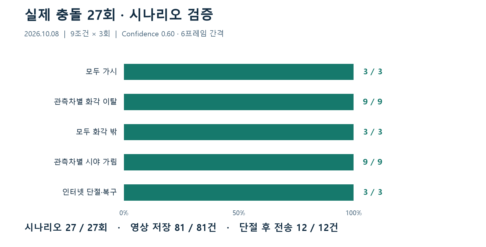
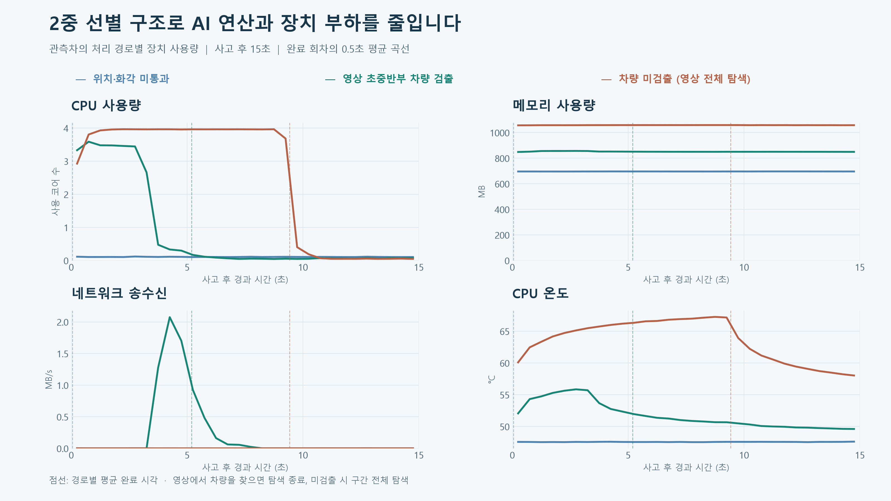
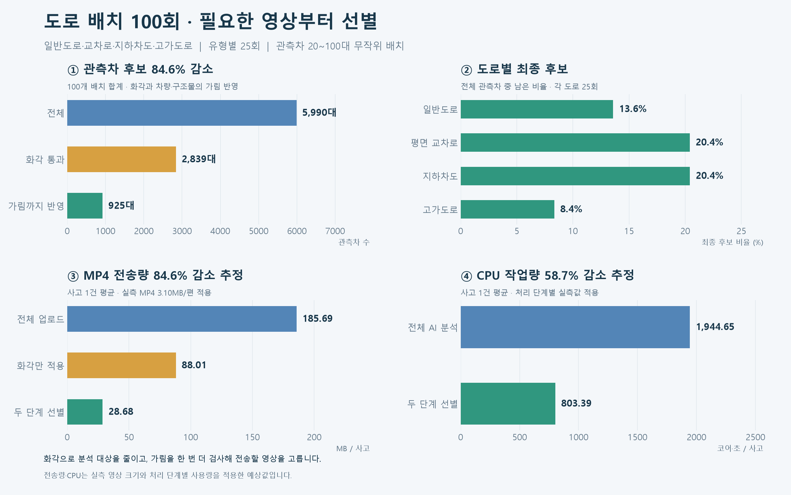
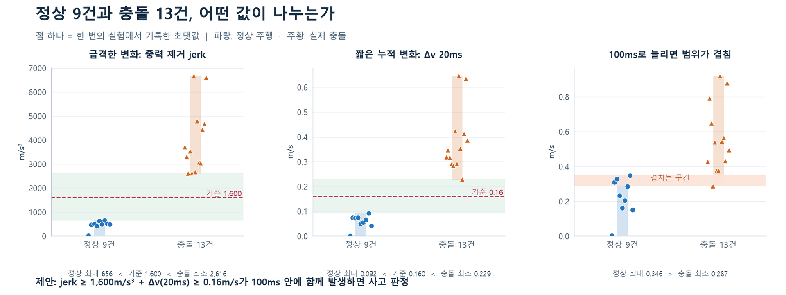
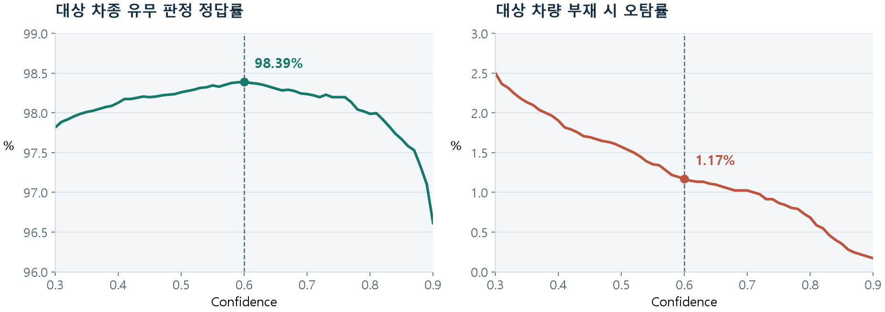

# 측정 결과 · 사고 전달부터 영상 저장까지

[프로젝트 소개로 돌아가기](../../README.md)

**장치에서 측정한 동작과 도로 시뮬레이션의 선별 효과를 함께 보여줍니다.** 그림에서 결과를 보고, 연결된 CSV와 분석 화면에서 사건별 기록을 확인할 수 있습니다.

| 알아볼 내용 | 결과와 자료 |
|---|---|
| 실제 충돌에서 선별·보존·전송되는가 | [27회 시나리오 검증](#실제-충돌-27회-시나리오-검증) · 9조건, 영상 81건 |
| 선별하면 장치 부담이 얼마나 줄어드는가 | [처리 단계별 부하](#처리-단계별-부하) · CPU·메모리·통신량·온도 |
| 차량 배치가 달라져도 효과가 있는가 | [도로 시뮬레이션](#도로-배치-100회--선별과-비용-환산) · 100개 배치의 선별량과 비용 환산 |
| 사고 알림과 시각 정보가 전달되는가 | [P2P 전달](#p2p-전달) · [차량 간 시각](#차량-간-시각) |
| 사고를 어떤 기준으로 판정하는가 | [IMU 사고 판정](#imu-사고-판정) · 22건의 주행·충돌 기록 |
| 영상 속 대상 차량을 얼마나 정확히 선별하는가 | [AI 프레임 검증](#ai-프레임-검증) · Confidence 선정과 대상 차종 유무 판정 |
| 각 처리 경로는 언제 끝나는가 | [종단 시간](#종단-시간) · 사건별 완료 기록 |

## 실제 충돌 27회 시나리오 검증

**9조건을 각각 3회 시험해 시나리오 판정 27 / 27회, 영상 서버 저장 81 / 81건을 확인했습니다.** 사고차 1대와 관측차 3대에 배포한 코드·모델·Confidence 0.60·6프레임 간격을 기록하고, 사건별 선별 결과와 영상 시작·종료 시각, 서버 저장 응답을 연결했습니다.

| 시험 조건 | 충돌 시험 | 사고차 영상 | 관측 영상 | 서버 저장 |
|---|---:|---:|---:|---:|
| 모두 가시 | 3회 | 3건 | 9건 | 12 / 12건 |
| 관측차별 화각 이탈 · 3개 배치 | 9회 | 9건 | 18건 | 27 / 27건 |
| 모두 화각 밖 | 3회 | 3건 | 0건 | 3 / 3건 |
| 관측차별 시야 가림 · 3개 배치 | 9회 | 9건 | 18건 | 27 / 27건 |
| 인터넷 단절 중 사고·복구 | 3회 | 3건 | 9건 | 12 / 12건 |
| **합계** | **27회** | **27건** | **54건** | **81 / 81건** |

<p align="center"><a href="20261008-scenarios/README.md"></a></p>

[시험 방법·대표 프레임·전체 CSV·사용 버전](20261008-scenarios/README.md)

## 처리 단계별 부하

**위치·화각에서 먼저 선별하면 영상 분석에 쓸 CPU를 줄일 수 있습니다.** 관측차의 평균 CPU 사용량은 화각 미통과 0.11코어, 영상 초중반부 차량 검출 0.87코어, 차량 미검출로 영상 전체 탐색 시 2.52코어였습니다.

[](../assets/resource-load.png)

| 사고 후 15초 평균 | 위치·화각 미통과 | 영상 초중반부 차량 검출 | 차량 미검출 · 영상 전체 탐색 |
|---|---:|---:|---:|
| CPU 사용 코어 수 | **0.109** | 0.866 | 2.519 |
| 메모리 사용량 | 696MB | 851MB | 1,059MB |
| 네트워크 송수신 | 0.210KB/s | 225.725KB/s | 0.314KB/s |
| CPU 온도 | 47.6°C | 51.7°C | 63.6°C |

서로 다른 차량에 각 처리 경로를 배치해 측정한 **장치 전체 사용량**입니다. AI는 사고 차량을 찾으면 탐색을 끝내고, 찾지 못하면 지정 구간 전체를 검사합니다.

<details>
<summary>그래프의 평균과 단위</summary>

- 사고 시각을 0초로 맞추고, 0.1초 원기록을 0.5초 간격으로 평균냈습니다.
- 위치 미통과는 해당 차량 두 대의 완료 회차 평균을 같은 비중으로 합쳤습니다.
- CPU는 4개 코어 중 사용량, 메모리는 `Total - Available`, 네트워크는 P2P·서버 Wi-Fi의 송수신 합계입니다.
- KB·MB는 각각 1,000·1,000,000바이트입니다.
- [회차별 부하 CSV](20260928-e2e/resource_cycles.csv) · [평균 곡선 CSV](20260928-e2e/resource_cycle_average.csv)

</details>

## 도로 배치 100회 · 선별과 비용 환산

**5,990대 → 화각 후보 2,839대 → 가림 반영 후보 925대.** 도로 시뮬레이션에서 일반도로·교차로·지하차도·고가도로를 각각 25회 실행하고, 매회 관측차 수와 배치를 바꿨습니다.

[](road-simulation/README.md)

| 비교 항목 | 기준 | 선별 적용 | 변화 |
|---|---:|---:|---:|
| 영상 분석 대상 | 5,990대 | 2,839대 | 52.6% 감소 |
| MP4 전송량 추정 · 사고 1건 평균 | 전체 업로드 185.69MB | 두 단계 선별 28.68MB | 84.6% 감소 |
| CPU 작업량 추정 · 사고 1건 평균 | 전체 AI 분석 1,944.65코어·초 | 두 단계 선별 803.39코어·초 | 58.7% 감소 |

도로 모형에서 화각과 차량·구조물의 가림을 계산해 후보를 선별했습니다. 여기에 실제 영상 크기와 처리 단계별 CPU 사용량을 적용한 예상값입니다.

[대표 화면·전체 CSV·계산식·재현 방법](road-simulation/README.md)

## IMU 사고 판정

**정상 주행 9건과 충돌 13건의 파형을 비교해 판정값을 정했습니다.**

[](../assets/imu-thresholds.png)

| 판정 기준 | 적용 값 |
|---|---:|
| 가속도 변화율 · jerk | 1,600m/s³ |
| 20ms 속도 변화량 · Δv | 0.16m/s |
| 두 조건의 동시 충족 범위 | 100ms |
| 수집 기록 재생 결과 | 정상 오탐 0건 · 충돌 검출 13건 |

정상·충돌 기록을 실제 C 판정 함수에 다시 넣어 동작을 검사했습니다. [사고 판정 코드와 사용법](../../sensor/README.md)

## AI 프레임 검증

**Confidence 0.60에서 검증용 12,873프레임의 유무 판정 정답률은 98.39%입니다.** 대상 차량 검출률은 97.62%, 대상 차량이 없는 프레임의 오탐률은 1.17%입니다.

테스트베드의 검증용 영상에 BBox 정답을 표시하고, 전체 프레임의 유무 판정 정답률이 가장 높은 임계값을 선정했습니다.

[](ai-evaluation/README.md)

[평가 조건·묶음별 결과·프레임 CSV](ai-evaluation/README.md) · [임계값별 결과 화면](ai-evaluation/index.html)

## P2P 전달

**이벤트 10,000개를 네 관측차에 전송해 39,990 / 40,000건(99.975%)을 수신했습니다.**

| 수신 장치 | 수신 건수 | 수신율 | 미수신 |
|---|---:|---:|---:|
| craft3 | 10,000 / 10,000 | 100.00% | 0 |
| craft4 | 9,993 / 10,000 | 99.93% | 7 |
| seongugi | 9,998 / 10,000 | 99.98% | 2 |
| craft6 | 9,999 / 10,000 | 99.99% | 1 |
| **합계** | **39,990 / 40,000** | **99.975%** | **10** |

수신한 사건은 모두 IPC로 한 번씩 전달했습니다. 중복 IPC 전달·큐 초과·디코딩·변환 오류·프로세스 재시작은 0건이었습니다. [집계 CSV](20261007-p2p/summary.csv) · [시험 결과와 원자료](20261007-p2p/README.md) · [P2P 동작](../../p2p/README.md)

## 차량 간 시각

**craft2와 각 관측차 사이의 절대 시간차 P95는 11.30~19.18ms였습니다.**

| 비교 대상 | 시간 교환 | 절대 시간차 P95 | 최대 시간차 |
|---|---:|---:|---:|
| craft3 | 10,000회 | 12.73ms | 17.32ms |
| craft4 | 10,000회 | 11.30ms | 15.77ms |
| seongugi | 10,000회 | 19.18ms | 22.73ms |
| craft6 | 10,000회 | 15.21ms | 22.46ms |

네트워크로 시각 정보를 주고받아 계산한 장치 간 시간차입니다. [집계 CSV](clock-summary-20260923.csv) · [Chrony 상태 조회](../../time_sync/README.md)

## 종단 시간

**사고 인식부터 영상 생성·영속성 큐 인계까지 평균 6.55초, 중앙값 5.25초입니다.** 실제 충돌 27회의 사고차·관측차 영상 81건을 집계했습니다.

| 완료 지점 | 건수 | 평균 | 중앙값 | P95 |
|---|---:|---:|---:|---:|
| 영상 생성·큐 인계 | 81 / 81 | 6.55초 | 5.25초 | 13.39초 |

시작은 IMU의 `event_time_ns`, 종료는 영상과 작업 보존을 마친 `CAMERA_READY_ACCEPTED` 응답 시각입니다. 서버 저장은 `storage_ack_confirmed=true`, `status=STORED` 응답으로 81건 모두 확인했습니다.

사건별 CSV에는 서버 저장 ACK 시각과 그때까지의 경과 시간도 함께 담았습니다. 서버 저장 경과 시간은 전송 대기와 인터넷 단절 시간을 포함합니다.

[영상별 시각·처리시간 CSV](20261008-scenarios/clips.csv) · [차량별 시간 집계](20261008-scenarios/timing.csv) · [단절 후 복구 12건](20261008-scenarios/recovery.csv)

<details>
<summary>수치와 도판 출처</summary>

처리 단계별 부하 실험의 집계값, 측정 조건, 원본과 공개본의 SHA-256을 [metrics.json](metrics.json)에 보관합니다. [종단 측정 자료](20260928-e2e/)에서 CSV·요약·분석 HTML을 볼 수 있습니다.

공개본은 로컬 파일 경로와 줄바꿈을 정리한 사본이며, 통계와 사건별 값은 유지했습니다. `provenance`에 원본·공개본 해시와 변환 내역을 연결해 두었습니다.

저장소 루트에서 현재 파일을 검증할 수 있습니다.

```sh
python scripts/measurements/verify_provenance.py
# 보관한 run 폴더가 있으면 원자료부터 공개본까지 함께 검증
python scripts/measurements/verify_provenance.py --source-root <run-directory>
```

검증기는 파일에서 계산한 해시를 기록된 값과 대조합니다.

처리 단계별 부하 도판은 `python scripts/measurements/render_module_metrics.py`로 생성합니다. Matplotlib과 한글 글꼴을 사용하며, 공개된 집계값·평균 곡선 CSV를 읽습니다.

</details>
