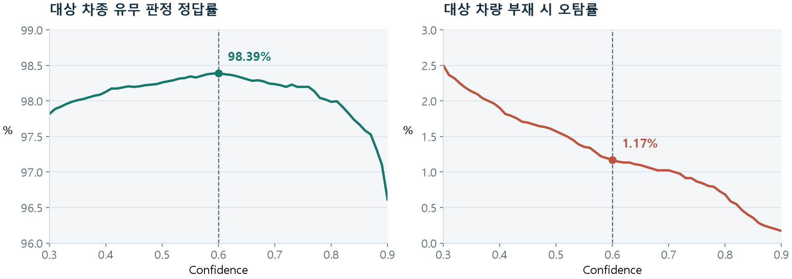

# AI 프레임 검증과 Confidence 선정

**검증용 12,873프레임에서 임계값별 유무 판정 정답률을 비교해, 가장 높은 정답률을 보인 Confidence 0.60을 선정했습니다.** 테스트베드에서 검증용으로 촬영한 영상에 BBox 정답을 표시하고, 각 프레임에서 대상 차종이 있는지 판정했습니다.



## 선정값의 결과

| 전체 BBox 검증 · 12,873프레임 | 결과 | 계산 |
|---|---:|---|
| 유무 판정 정답률 | **98.39%** | (검출 정답 4,560 + 부재 정답 8,106) / 12,873 |
| 대상 차량 검출률 | **97.62%** | 4,560 / 대상 차량이 있는 4,671 |
| 대상 차량 부재 시 오탐률 | **1.17%** | 96 / 대상 차량이 없는 8,202 |

| 정답 / 예측 | 대상 차량 있음 | 대상 차량 없음 |
|---|---:|---:|
| 대상 차량 있음 | 4,560 | 111 |
| 대상 차량 없음 | 96 | 8,106 |

임계값을 0.001과 0.01~1.00의 0.01 간격으로 비교했습니다. 대상 차종의 유무 판정에서는 BBox 정답에 대상 차량이 있는지와 모델이 대상 차종을 검출했는지를 비교합니다. 박스 위치까지 평가하는 항목에는 IoU 0.50 기준을 적용합니다.

## 평가 조건과 장치 설정

| 항목 | 값 |
|---|---|
| 평가 모델 | YOLOX-Tiny 2-class · `tiny_blur_removed_v009_b8` |
| 모델·데이터 | checkpoint epoch 1 · `dataset_v009` |
| 검증 자료 | 테스트베드 검증용 영상의 BBox 정답 프레임 |
| 클래스 | `ioniq5_silver` / `other_vehicle` |
| 입력 | 640×480 · BGR FP32 NCHW · 0~255 · top-left letterbox 114 |
| 검출 점수 | objectness × class score ≥ **0.60** |
| NMS | class별 IoU **0.65** |
| 평가 프레임 추출 간격 | 원본 영상 5프레임 간격 |
| 장치 추론 간격 | **6프레임** |
| 장치 영상 선별 | 최근 추론 **3회 중 2회** 대상 차량 검출 |

## 평가 묶음별 결과

모든 수치는 Confidence 0.60에서 계산했습니다. 전체는 아래 묶음을 포함한 12,873프레임입니다.

| 평가 묶음 | 프레임 수 | 유무 정답률 | 대상 차량 검출률 | 부재 시 오탐률 |
|---|---:|---:|---:|---:|
| 전체 BBox 검증 | 12,873 | 98.39% | 97.62% | 1.17% |
| 테스트베드 촬영 검증 | 3,314 | 97.50% | 94.09% | 0.73% |
| 검증 묶음 val | 1,358 | 93.67% | 95.03% | 6.99% |
| 시험 묶음 test | 1,633 | 98.65% | 97.55% | 0.75% |

## 자료와 재계산

| 파일 | 내용 |
|---|---|
| [평가 화면](index.html) | 평가 묶음·Confidence별 그래프와 혼동행렬 |
| [선정값 결과](selected_threshold_metrics.csv) | Confidence 0.60의 묶음별 집계 |
| [임계값별 결과](threshold_metrics.csv) | 전체 임계값의 유무 판정 및 class별 BBox 집계 |
| [프레임 상세](frame_results.csv) | 프레임 ID·시각·정답·검출 점수·0.60 판정·BBox |
| [평가 조건](evaluation_conditions.csv) | 모델·데이터·판정 규칙·해시 |
| [자료 연결 기록](source_manifest.json) | 원자료와 공개 CSV의 SHA-256 |

`frame_results.csv`의 `evaluation_group`은 `reference`, `testbed`, `val`, `test` 평가 묶음을 나타냅니다. 원본 프레임·영상 SHA-256으로 각 행의 자료를 연결합니다.

저장소 루트에서 다음 명령으로 CSV 집계를 대조하고 그래프·평가 화면을 생성합니다. Python과 Matplotlib, 한글 글꼴을 사용합니다.

```bash
python docs/measurements/ai-evaluation/render.py
```

[AI 실행 구조](../../../ai/README.md) · [모델 학습·내보내기](../../../model_training/README.md) · [전체 측정 결과](../README.md)


## 실제 장치 시나리오 검증

**Confidence 0.60·6프레임 간격·최근 3회 중 2회 검출을 적용한 실제 충돌 27회에서 시나리오 판정 100%를 확인했습니다.** 모두 가시, 관측차별 화각 이탈·시야 가림, 모두 화각 밖, 인터넷 단절·복구의 9조건을 각 3회 시험했습니다. 사고차 영상 27건과 선별된 관측 영상 54건이 서버에 저장됐습니다.

[사건별 판정·영상 구간·서버 저장 CSV와 사용 버전](../20261008-scenarios/README.md)
