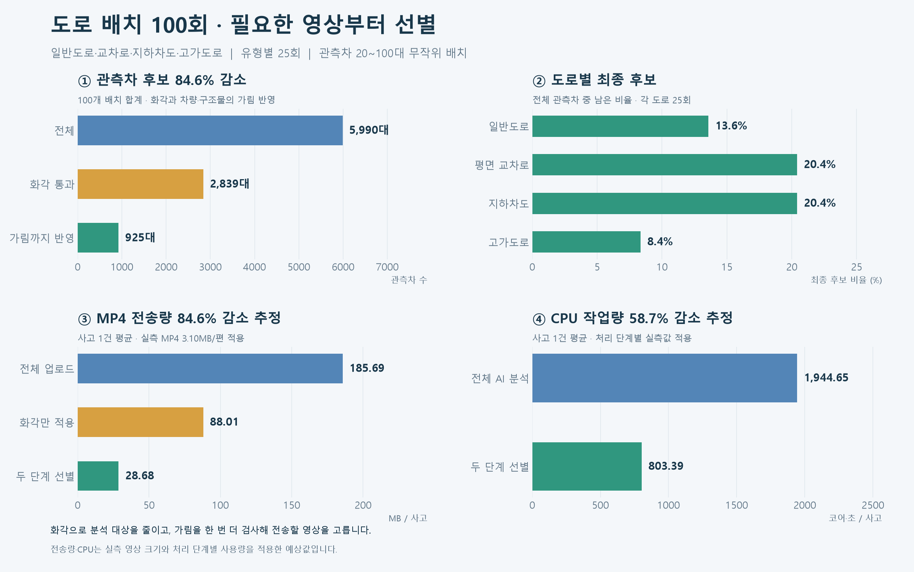
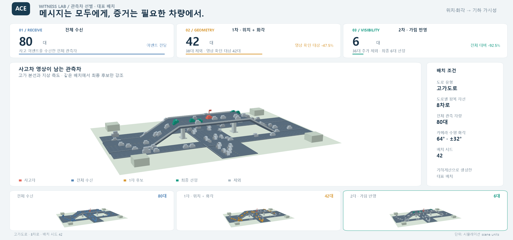

# 도로 배치 100회 · 필요한 영상만 남겼을 때의 비용

[측정 결과로 돌아가기](../README.md)

**관측차 5,990대 중 화각 후보 2,839대, 가림을 반영한 영상 후보 925대.** 차량 수와 배치를 바꾼 100개 도로 장면에서 같은 선별 구조를 반복 실행했습니다.



| 사고 1건당 평균 | 전체 대상 | 화각 통과 | 가림까지 반영 |
|---|---:|---:|---:|
| 관측차 수 | 59.90대 | 28.39대 | 9.25대 |
| MP4 전송량 추정 | 185.69MB | 88.01MB | 28.68MB |

**영상 전송량은 전체 업로드 대비 84.6% 감소, CPU 작업량은 전체 차량 AI 분석 대비 58.7% 감소로 추정됩니다.** 실제 영상 크기·경로별 장치 부하를 아래의 가정에 적용한 비교계산입니다.

## 어떤 배치를 실행했나



대표 배치: 고가도로 8차로·관측차 80대·seed `42`에서 화각 후보 42대, 가림을 반영한 후보 6대를 고르는 장면입니다.

| 조건 | 설정 |
|---|---|
| 도로 | 일반도로·평면 교차로·지하차도·고가도로 각 25회 |
| 관측차 | 장면마다 20~100대 중 5대 간격으로 무작위 선택, 겹치지 않게 배치 |
| 고정 조건 | 6차로, 도로별 형상, 사고 위치·방향 |
| 1차 | 사고차의 차체 범위가 카메라 수평 화각 ±32°와 겹치는가 |
| 2차 | 화각 안에 있는 사고차의 일부가 다른 차량·구조물에 가리지 않고 보이는가 |
| 재현 | master seed `20261006`; 각 배치 seed·좌표·판정을 CSV에 저장 |

**사고 방향을 보고 있어도 앞차나 도로 구조물 때문에 사고차가 가려질 수 있습니다.** 도로 모형에서 사고차가 보이는지를 계산해, 화각 후보를 한 번 더 선별했을 때 남는 차량 수를 구했습니다.

| 도로 · 각각 25회 | 전체 관측차 | 화각 후보 | 가림 반영 후보 | 전체 대비 감소 |
|---|---:|---:|---:|---:|
| 일반도로 | 1,465 | 712 | 199 | 86.42% |
| 평면 교차로 | 1,460 | 707 | 298 | 79.59% |
| 지하차도 | 1,425 | 679 | 291 | 79.58% |
| 고가도로 | 1,640 | 741 | 137 | 91.65% |
| **합계** | **5,990** | **2,839** | **925** | **84.56%** |

1차가 전체의 **52.60%를 제외**하고, 2차가 남은 후보의 **67.42%를 추가로 제외**했습니다. 비율은 100개 장면의 차량 수를 합산해 계산했습니다.

## MB와 CPU 작업량은 어떻게 계산했나

**실제 저장된 MP4 100건의 평균 크기 3.10MB와 처리 단계별 CPU 측정값을 사용했습니다.** 같은 단가를 각 배치의 차량 수에 곱해, 모든 차량을 처리할 때와 선별 후 처리할 때를 비교했습니다.

| 사고 후 15초의 처리 경로 | 평상시 사용량을 뺀 CPU 작업량 |
|---|---:|
| 화각 미통과 | 약 0.00068코어·초 |
| 영상 초중반부 차량 검출 · 인코딩·업로드 | 11.90613코어·초 |
| 차량 미검출 · 영상 전체 탐색 | 36.21952코어·초 |

CPU 작업량은 **(사고 후 평균 코어 사용량 − 같은 장치의 평상시 평균) × 15초**로 계산했습니다. CPU 1코어를 1초 사용한 양이 1코어·초입니다. 차량을 찾지 못하면 영상을 끝까지 탐색하므로, 영상 초중반에 차량을 찾은 경우보다 CPU를 오래 사용했습니다.

| 비교계산 · 100개 사고 장면 합계 | 기준 | 선별 적용 | 감소 |
|---|---:|---:|---:|
| MP4 전송량 | 전체 업로드 18,569.34MB | 두 단계 2,867.55MB | **84.56%** |
| CPU 작업량 | 전체 AI 분석 194,465.02코어·초 | 두 단계 80,339.48코어·초 | **58.69%** |

<details>
<summary>계산식과 적용 범위</summary>

- `N`: 전체 관측차, `N1`: 화각 통과, `N2`: 가림까지 통과, `V`: 차체 표본의 화각·가림 계산에서 사고차가 보이는 관측차.
- `S`: MP4 평균 크기. 전체 업로드=`N×S`, 화각만 적용=`N1×S`, 두 단계=`N2×S`.
- `Cf`, `Cn`, `Cp`: 각각 화각 미통과, 영상 전체 탐색, 영상 초중반부 차량 검출·저장의 실측 CPU 단가.
- 전체 차량 AI 분석=`V×Cp+(N−V)×Cn`.
- 두 단계 선별=`(N−N1)×Cf+(N1−N2)×Cn+N2×Cp`.
- 사고차가 보이는 차량에는 검출·저장 비용, 가려진 차량에는 영상 전체 탐색 비용을 적용했습니다.
- 전송량 비교의 기준은 **전체 업로드**, CPU 비교의 기준은 **전체 차량 AI 분석**입니다.
- 비교 대상은 **관측차의 영상 처리와 MP4 전송량**이며, 모든 관측 영상에 같은 평균 크기·처리 단가를 적용했습니다.
- MB는 1,000,000바이트입니다. MP4 본문 크기를 기준으로 계산했고, 메타데이터는 영상당 292바이트로 별도 기록했습니다.
- 실측 단가의 영상 구성은 **사고 전 10초**입니다.
- 도로 형상·사고 위치를 유형별로 고정하고, 차량 수·배치를 바꾸어 선별량을 비교했습니다.

</details>

## 결과와 재현

| 파일 | 내용 |
|---|---|
| [scenarios.csv](scenarios.csv) · [summary.json](summary.json) | 100개 배치의 단계별 수량·seed·도로별 통계 |
| [vehicles.csv](vehicles.csv) | 5,990대의 위치·방향·각 단계 판정·가시 표본 비율 |
| [example.json](example.json) | 대표 배치의 도로·차량 좌표·단계별 판정과 도판 원자료 |
| [clip_sizes.csv](clip_sizes.csv) | 실제 MP4 100건의 작업 ID·크기·메타데이터 크기·원로그 행 |
| [cost_inputs.json](cost_inputs.json) | 단가 출처·원자료 해시·계산 가정 |
| [cost_estimates.csv](cost_estimates.csv) · [cost_summary.json](cost_summary.json) | 배치별 비용과 전체·도로별 합계 |
| [simulator.html](simulator.html) | 내려받아 브라우저로 여는 도로 시뮬레이터 |

저장소 루트에서 실행합니다. Node.js와 Python 표준 라이브러리로 계산하며, 도판 생성에는 Matplotlib이 필요합니다.

```sh
# 저장 결과와 동일하게 재현되는지 검사
node docs/measurements/road-simulation/run_batch.cjs --check
node docs/measurements/road-simulation/export_example.cjs --check
node --test docs/measurements/road-simulation/test_batch.cjs
python scripts/measurements/estimate_road_costs.py --check

# 결과와 도판 다시 생성
node docs/measurements/road-simulation/run_batch.cjs
python scripts/measurements/estimate_road_costs.py
python scripts/measurements/render_road_results.py
node docs/measurements/road-simulation/export_example.cjs
python scripts/measurements/render_road_example.py
```

원자료 보관 폴더가 있으면 비용 검증에 `--source-root <run-directory>`를 붙여 원로그와 추출 CSV까지 대조할 수 있습니다.
