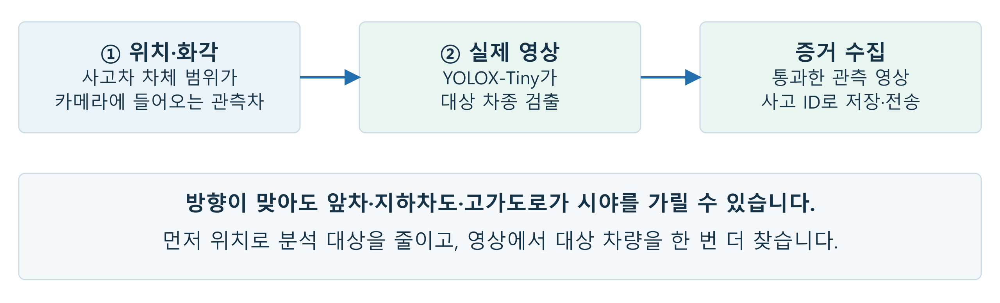
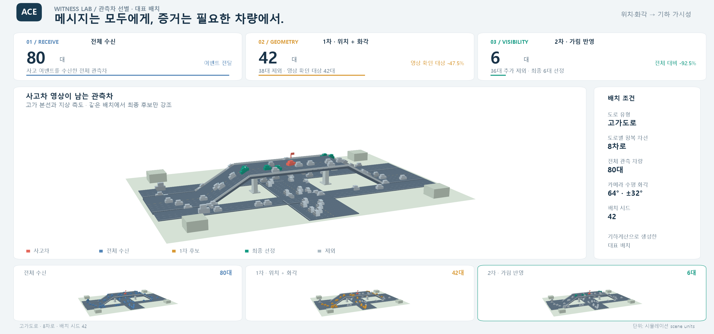

# Witness Filter — 필요한 관측차부터 고르는 1차 선별

**사고차의 위치와 차체 범위를 카메라 방향·화각에 대입해, 영상을 분석할 관측차를 고릅니다.** 위치·화각을 통과한 사고는 AI 모듈에 즉시 전달하고, AI가 실제 영상에서 대상 차량을 한 번 더 찾습니다.

[](../docs/assets/vision-two-stage.png)

## 두 번 선별하는 이유

**사고 방향을 보고 있어도 앞차나 지하차도·고가도로 구조물에 가려질 수 있습니다.** 먼저 좌표 계산으로 AI 분석 대상을 줄이고, 실제 영상에서 대상 차량을 검출한 관측차가 증거를 보냅니다.

[](../docs/measurements/road-simulation/README.md)

같은 차종이 여러 대 있더라도 사고 장소를 촬영한 영상을 모으면, 사고 전후 각 차량의 접근과 충돌 장면을 함께 살펴볼 수 있습니다. **사고 위치로 수집 범위를 좁히고, 여러 시점의 영상으로 사건을 확인하는 구조**입니다.

## 선별이 줄이는 분석·전송량

일반도로·교차로·지하차도·고가도로의 차량 수와 배치를 바꾼 **도로 시뮬레이션 100회**에서 단계별 후보 수를 계산했습니다.

| 전체 관측차 | 위치·화각 통과 | 가림을 반영한 영상 후보 |
|---:|---:|---:|
| **5,990대** | **2,839대** | **925대** |

실측 영상 크기와 처리 단계별 CPU 사용량을 이 후보 수에 적용하면, 전체 관측차가 전송하는 경우보다 **영상 전송량 84.6%**, 전체 관측차가 AI를 수행하는 경우보다 **CPU 작업량 58.7%** 감소로 계산됩니다.

| 장치 실측 · 사고 후 15초 평균 | CPU 사용 코어 수 | 메모리 |
|---|---:|---:|
| 위치·화각 미통과 | **0.109** | 696MB |
| 영상 초중반부 차량 검출 | 0.866 | 851MB |
| 차량 미검출 · 영상 전체 탐색 | 2.519 | 1,059MB |

관측차의 배치와 방향을 고정해, 촬영 조건을 유지하면서 **위치 선별 → 차량 검출 → 영상 저장**에 따른 부하를 비교했습니다. 대상 차량을 일찍 찾으면 영상 탐색을 마치고 저장하며, 찾지 못하면 사고 구간 전체를 검사합니다.

[도로 시뮬레이션·계산식·전체 CSV](../docs/measurements/road-simulation/README.md) · [장치 부하 그래프·원자료](../docs/measurements/README.md#처리-단계별-부하)

## 판정 기준

| 항목 | 값·동작 |
|---|---|
| 좌표 | X/Y mm, Windows 추적부와 같은 로컬 좌표계 |
| 방향 | +Y=0°, +X=90°, 시계 방향 증가 |
| 카메라 중심 | 관측차 `heading_deg` |
| 수평 화각 | `CAMERA_FOV_DEG = 64.0f` → 중심에서 좌우 32° |
| 관측 후보 | 사고차의 차체 범위와 카메라 화각이 겹치면 통과 |
| 사고차 크기 | 중앙 마커·1:18 아이오닉 5, 257.5 × 105mm; 차체 외접원 반경 약 139.04mm |
| 거리 | 차체 반경과 거리로 영상에 걸치는 차체의 각도 범위를 계산 |

```text
dx = 사고차 x - 관측차 x
dy = 사고차 y - 관측차 y
bearing_deg = atan2(dx, dy) × 180 / π
heading_error = bearing_deg와 heading_deg 사이의 최소 각도 차이
```

방향은 0° 이상 360° 미만으로 정규화합니다. 359°와 1°의 차이는 2°입니다. 카메라의 수평 화각은 64°입니다. 사고차 중심에서 차체 모서리까지의 반경 `R`과 차량 간 거리 `d`를 사용해, `방향 차이 ≤ 32° + asin(R/d)`이면 후보로 보냅니다. `d ≤ R`인 근접 배치도 후보에 포함합니다. 판정 코드는 [`witness_fov.h`](witness_fov.h)에 있습니다.

기본 차체 크기는 [현대자동차 아이오닉 5 제원](https://www.hyundai.com/content/dam/hyundai/au/en/models/ioniq5/images/IONIQ5_SpecTable_Sept_2021.pdf)의 전장 4,635mm·전폭 1,890mm를 1/18로 환산했습니다. 다른 크기의 사고차를 사용하면 `witness_filter.service`의 systemd drop-in에 `Environment=WITNESS_TARGET_RADIUS_MM=<반경 mm>`를 지정할 수 있습니다. 설정값은 서비스 시작 시 적용합니다.

## 위치 대기와 전달 재시도

고정 배치 관측차의 최초 정상 위치를 확보하면 센서 IPC가 끊겨도 그 위치·방향을 유지합니다. 새 정상 측정이 들어오면 갱신합니다. 위치보다 사고가 먼저 도착하면 최초 위치를 받을 때까지 사고 ID와 시각을 보관합니다.

| 상황 | 처리 |
|---|---|
| 최초 위치 없음 | Worker가 사고를 보관하고 조건변수에서 대기 |
| Inference 연결·송신 실패 | 같은 사고 ID·시각으로 500ms마다 재시도; 연결·쓰기 대기 200ms 제한 |
| 전달 대기 중 새 입력 | Sensor·P2P 수신 스레드가 계속 접수 |
| Filter 재시작 | RAM 위치·사고 Queue 초기화; 정상 위치부터 다시 확보 |
| 관측차 이동 | 새 ArUco 측정으로 위치·카메라 방향 갱신 |

## 입출력

| 연결 | Unix socket | 메시지 / payload |
|---|---|---|
| 관측차 Sensor → Filter | `/tmp/witness_sensor.sock` | `IPC_MSG_SENSOR_DATA` / `vehicle_state_t` |
| P2P Receiver → Filter | `/tmp/filter.sock` | `IPC_MSG_ACCIDENT_CONFIRM` / `accident_event_t` |
| Filter → Inference | `/tmp/inference_event.sock` | `IPC_MSG_INFERENCE_EVENT` / `inference_event_t` |

통과한 사고의 `station_id`, `sequence_number`, `detection_time`을 그대로 전달합니다. 로그에는 `Witness Candidate : YES`를 남기고 GPIO4 LED를 마지막 통과 시점부터 5초간 켭니다. AI 검출 결과 LED는 [Inference의 GPIO17](../ai/README.md)이 담당합니다.

## 빠른 시작

관측차의 저장소 루트에서 빌드하고 서비스를 등록합니다.

```bash
make -C filter
sudo sh filter/deploy/install-service.sh
systemctl status witness_filter.service
```

`craft3`·`craft4`·`craft5`·`seongugi`·`craft6`에서 `test/witness_filter`를 root로 실행합니다. Inference도 함께 시작하며, 필요한 Sensor·P2P 소켓을 만들지 못하면 실패 종료합니다.

## 상세 통신 규약과 운영

<details>
<summary>입력 데이터·시각·사고 ID</summary>

입력 자료형은 [`sensor_protocol.h`](../ipc/sensor_protocol.h)와 [`filter_protocol.h`](../ipc/filter_protocol.h), Inference 전달 자료형은 [`inference_protocol.h`](../ipc/inference_protocol.h)에 정의되어 있다.

| 입력 | 필드 | 의미 |
|---|---|---|
| 관측차 상태 | `x_mm`, `y_mm` | 테스트보드의 로컬 위치, mm |
| 관측차 상태 | `heading_deg` | 카메라 중심 방향, 도 |
| 관측차 상태 | `detection_time` | 마지막 정상 ArUco 촬영 시각, Pi CLOCK_MONOTONIC ns |
| 사고 이벤트 | `station_id`, `sequence_number` | 사고를 식별하는 ActionID의 두 필드 |
| 사고 이벤트 | `x_mm`, `y_mm` | 사고 차량의 로컬 위치, mm |
| 사고 이벤트 | `detection_time` | P2P에서 변환한 사고 시각, Unix epoch ns |

로그의 `action_id`는 `(station_id << 16) | sequence_number`를 10진수 문자열로 만든 값이다. Inference에는 두 ID 필드와 사고 시각을 그대로 전달한다.

</details>

<details>
<summary>수신·판정 스레드와 공유 자원</summary>

```text
관측차 센서 → Sensor Thread → 최신 정상 위치·카메라 방향
                                      │
P2P → V2V Thread → 사고 FIFO → Filter Worker
                                      │
                               위치 사본 확보
                                      │
                         상대 위치·방향·화각 계산
                                      │
                            관측 후보 로그 / Inference 전달
```

- **Sensor Thread:** 메시지 종류와 크기를 확인하고 정상 위치를 저장한다. X/Y와 heading은 유한한 값이어야 하며, X/Y 범위는 ±1,000,000mm, heading 범위는 `0 ≤ heading < 360`이다.
- **V2V Thread:** 사고 메시지를 받아 FIFO 뒤에 추가한다. 연결이 종료되면 다음 P2P 연결을 기다린다.
- **Filter Worker:** FIFO에서 사고를 하나씩 꺼낸 뒤 관측차 위치의 사본으로 판정한다. 최초 위치가 없으면 꺼낸 사고를 보관한 채 조건변수에서 기다린다. 그동안 들어온 사고는 FIFO에 쌓인다.

FIFO와 위치 사본은 각각 mutex로 보호한다. 위치 계산은 사본을 가져온 뒤 mutex를 풀고 수행한다. 빈 FIFO와 최초 위치를 기다릴 때는 조건변수를 사용한다.

</details>

<details>
<summary>서비스 로그·수동 실행·watchdog</summary>

```bash
journalctl -u witness_filter.service -f
sudo systemctl stop witness_filter.service
sudo ./test/witness_filter
# Ctrl+C로 수동 실행 종료 후
sudo systemctl start witness_filter.service
```

Sensor·P2P 수신과 판정 스레드가 자신의 진행 기한을 갱신한다. 정지하면 watchdog 알림을 중단하여 systemd가 재시작하며, 일반 실패 종료는 5초 후 재시작한다. 사고가 없거나 최초 위치·Inference 연결을 기다리는 루프도 정상 대기를 갱신한다.

메시지 일부를 받은 뒤 2초 안에 헤더·본문을 완성하지 못하면 해당 IPC 연결을 닫고 다음 연결을 받는다. 위치와 사고 FIFO는 각각 mutex로 보호하고 계산은 위치 사본을 확보한 뒤 잠금을 풀고 수행한다.

</details>

[프로젝트 소개](../README.md) · [AI 영상 선별](../ai/README.md)
