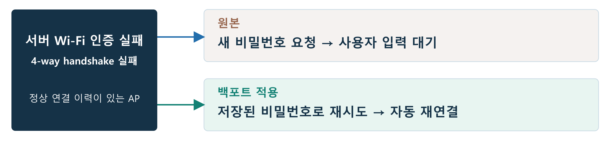
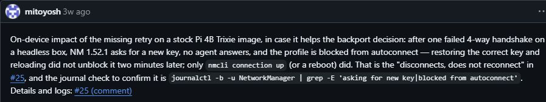

# 서버 Wi-Fi 자동 재연결 · NetworkManager 백포트

**연결이 끊긴 뒤 비밀번호 입력을 기다리며 멈추는 문제를 해결해, 서버 Wi-Fi 자동 재접속과 영상 전송을 이어갑니다.**

[프로젝트 소개](../README.md) · [영속성 큐·업로더](../uploader/README.md) · [차량 간 P2P](../p2p/README.md) · [Pi 5 검증 결과](TEST-RESULTS.md)

## 4-way handshake 실패 후에도 자동으로 다시 연결

Raspberry Pi OS Trixie의 NetworkManager 1.52.1은 WPA-PSK 인증 실패 때 **이전에 연결했던 비밀번호를 재사용하지 않고 새 비밀번호를 요청**했습니다. 이 때문에 무인 장치가 입력 대기에 머무르며 자동 재연결을 이어가지 못했습니다.

[](../docs/assets/comms-nm-backport.png)

상위 NetworkManager의 인증 재시도 개선을 Trixie 패키지로 백포트했습니다. **정상 연결 이력이 있는 Wi-Fi는 저장된 비밀번호로 계속 재시도**하고, AP 재검색 간격도 3~5초로 설정했습니다. 서버 연결이 복구되면 업로더가 영속성 큐의 영상을 전송합니다.

## Pi 5 비교시험과 공개 제안

정상 연결을 완료한 시험 프로필에 임시로 잘못된 비밀번호를 설정하고, `auth-retries=0`에서 원본과 백포트를 각각 **45초간 비교**했습니다.

| 인증 실패 후 동작 | 원본 패키지 | 인증 재시도 백포트 |
|---|---:|---:|
| 저장된 비밀번호로 재시도 | 0회 | **8회** |
| 새 비밀번호 요청 | 1회 | **0회** |

정상 비밀번호 복구 후 재연결과 재시도 설정 유지까지 확인했습니다. [전체 시험 결과](TEST-RESULTS.md)

[](https://github.com/raspberrypi/trixie-feedback/issues/102)

**Raspberry Pi OS 공개 제안 #102**에 백포트와 검증 결과를 제출했습니다. 외부 사용자 2명도 Pi 4와 Pi 3에서 동일한 자동 재연결 장애를 재현해 보고했습니다.

<details>
<summary><strong>외부 사용자의 동일 장애 재현 기록</strong></summary>

[](https://github.com/raspberrypi/trixie-feedback/issues/102#issuecomment-5717939516)

[](https://github.com/raspberrypi/trixie-feedback/issues/102#issuecomment-6017467733)

</details>

## 적용 대상

| 인터페이스 | 역할 | 관리 방식 |
|---|---|---|
| `wlan0` | 차량 간 P2P | 기존 수동 wpa_supplicant 유지 |
| `wlan1` | 서버 AP 연결 | NetworkManager 자동 재연결 |

| 패키지 | 버전 |
|---|---|
| 설치 대상 | `1.52.1-1+rpt4` 또는 `1.52.1-1+rpt4+codex1` |
| 설치 결과 | `1.52.1-1+rpt4+codex2` |
| 주기적 검색 | 최소 3초 · 최대 5초 |

## 설치

**Pi 로컬 터미널에서** 실행합니다. 설치 과정에서 NetworkManager가 재시작되어 서버 Wi-Fi 연결이 잠시 끊깁니다.

```bash
cd networkmanager-backport
sudo bash apply-nm-backport.sh --check
sudo bash apply-nm-backport.sh
```

현재 `wlan1`에 연결된 Wi-Fi 설정을 사용합니다. 연결이 끊긴 상태에서는 `wlan1`용으로 저장된 설정이 하나면 자동 선택합니다. 사용할 Wi-Fi 설정을 직접 지정하려면 다음을 실행합니다.

```bash
sudo bash apply-nm-backport.sh "Wi-Fi 프로필 이름"
```

비밀번호를 재사용할 수 있도록 장치 초기 설정에서 해당 AP에 정상 연결을 한 번 완료합니다. 설치한 재시도 설정은 재부팅 후에도 유지됩니다.

## 적용하는 설정

| 설정 | 적용 값·의미 |
|---|---|
| `connection.interface-name` | `wlan1`에 프로필 고정 |
| `connection.auth-retries` | `0` · 인증 재시도 무제한 |
| `connection.autoconnect` | `yes` · 자동 연결 |
| `connection.autoconnect-retries` | `0` · 자동 연결 재시도 무제한 |

<details>
<summary>설치 검사와 백업</summary>

설치 전에 체크섬·OS·패키지 버전·Wi-Fi 프로필·APT 변경 계획을 검사합니다.

- `wlan0`이 현재 NM 관리 제외 상태인지, 재시작 후에도 유지되는 제외 규칙이 있는지 검사합니다. `keyfile.unmanaged-devices` 또는 `device`의 `managed=0`을 사용합니다.
- `wlan1`은 NM 관리 상태여야 하며 다른 인터페이스에 묶인 프로필은 받지 않습니다.
- APT가 wpasupplicant 등 관련 없는 패키지를 변경하려 하면 설치 전에 멈춥니다.
- NM 재시작 후 `wlan0`의 관리 제외 상태를 다시 검사하고 `wlan1`을 연결합니다. wlan0 설정과 수동 제어 서비스는 수정하지 않습니다.

기존 NetworkManager·Netplan 설정과 패키지 버전은 `/var/backups/nm-backport.XXXXXXXX/`에 보관합니다. 실패하면 오류를 출력하며, 동일한 설치 버전에서도 다시 실행할 수 있습니다.

</details>

<details>
<summary>포함 파일과 소스 재빌드</summary>

| 경로 | 내용 |
|---|---|
| [apply-nm-backport.sh](apply-nm-backport.sh) | 패키지 설치·재시도 설정 |
| [tools/check_wlan0_policy.py](tools/check_wlan0_policy.py) | wlan0 관리 제외 검사 |
| `packages/` | ARM64·공통 아키텍처 패키지 9개 |
| `patches/` · `sources/` | 적용 패치·배포 패키지 소스 |
| [TEST-RESULTS.md](TEST-RESULTS.md) | 인증 재시도 백포트 `codex1`의 Pi 5 시험 결과 |
| `LICENSES/` · `SHA256SUMS` | 라이선스·저작권·체크섬 |

Trixie 빌드 환경에서 의존성을 설치한 뒤 실행합니다.

```bash
dpkg-source -x sources/network-manager_1.52.1-1+rpt4+codex2.dsc /tmp/network-manager-backport-build
cd /tmp/network-manager-backport-build
dpkg-checkbuilddeps
dpkg-buildpackage -b -us -uc -j4
```

`0001-debian-backport-known-psk-auth-retries.patch`는 원본 Debian 패키징 Git 트리에 `git am`으로 적용하는 인증 재시도 패치입니다. `0002-wifi-cap-periodic-scan-at-5-seconds.patch`는 최대 스캔 간격을 120초에서 5초로 바꿉니다. 배포 패키지와 소스에는 두 변경이 이미 반영되어 있습니다.

</details>

## 출처와 기여

인증 재시도 백포트·실기 검증: **Kim Wooseok <5mghybrid@khu.ac.kr>** · [kingwooseok](https://github.com/kingwooseok)

상위 NetworkManager의 아래 변경을 백포트했습니다. 원 저자와 기여자는 패치에 기록되어 있습니다.

- [인증 재시도 조회](https://github.com/NetworkManager/NetworkManager/commit/a3267aaf7bfab66604b2a6e69973301bb7f9b867) · [남은 재시도 판정](https://github.com/NetworkManager/NetworkManager/commit/6dc51ddf01afe790bcf48d93192a0e535987334e)
- [저장된 비밀번호 재사용](https://github.com/NetworkManager/NetworkManager/commit/746a5902ad85ec0611a3e6ebfd7b68b45621a40b) · [CONFIG 상태 조건](https://github.com/NetworkManager/NetworkManager/commit/6dd07a80e535a2e76e7304c92d4db97097af98a4)
- [Raspberry Pi OS 반영 제안](https://github.com/raspberrypi/trixie-feedback/issues/102)

[업로더](../uploader/README.md) · [P2P](../p2p/README.md) · [프로젝트 소개](../README.md)
