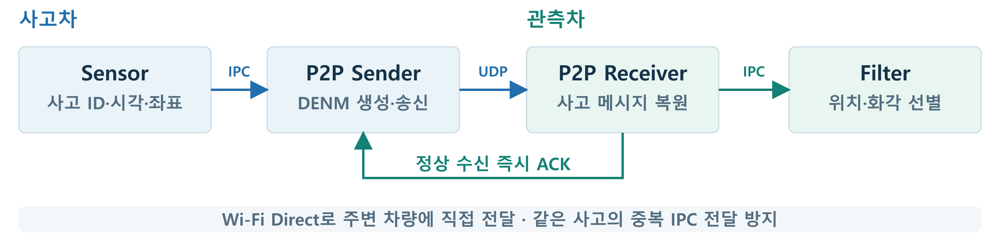
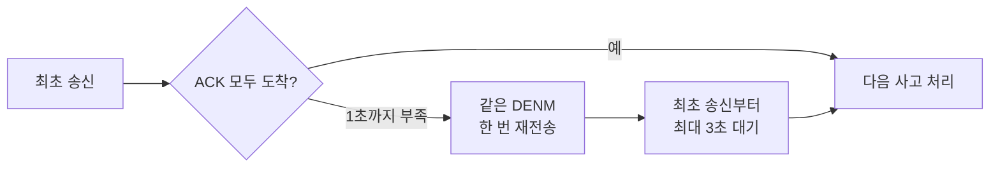
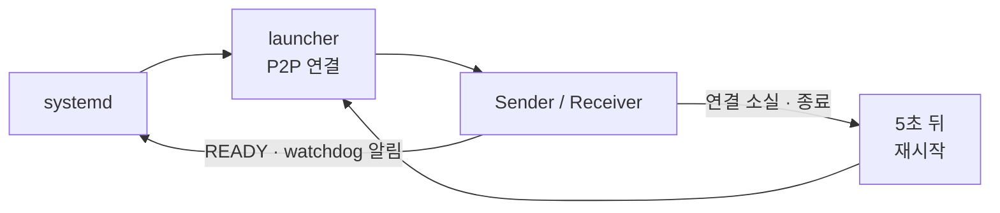

# 차량 간 사고 전달 · P2P

**인터넷을 거치지 않고 주변 차량에 사고를 알리고, 같은 사고가 관측차에 한 번씩 전달되도록 처리합니다.**

[프로젝트 소개](../README.md) · [센서](../sensor/README.md) · [위치 필터](../filter/README.md) · [IPC](../ipc/README.md) · [배포](../scripts/README.md)

## 사고 한 건의 전달 흐름

[](../docs/assets/comms-p2p-flow.png)

사고차의 Sensor가 확정한 사고 시각·좌표를 **Wi-Fi Direct로 연결된 주변 차량에 한 번에 전송**합니다. 관측차는 수신 확인(ACK)을 먼저 보내고, 사고 정보를 위치·화각 필터로 넘깁니다.

| 역할 | 입력 | 출력 |
|---|---|---|
| **Sender · 사고차** | Sensor의 사고 이벤트 | 그룹 전체로 DENM 송신, 차량별 ACK 집계 |
| **Receiver · 관측차** | DENM 사고 패킷 | 정상 복원 즉시 ACK, Filter IPC 전달 |
| **Heartbeat** | GO·Client의 주기적 응답 | 연결 이상 감지와 재접속 유도 |

## 반복시험으로 확인한 전달 성능

**사고 알림 10,000개 × 관측차 4대에서 39,990 / 40,000건을 수신했습니다.** 실제 송수신 코드의 ACK·재전송을 사용하고, 사건 식별자로 중복 패킷을 합쳐 집계했습니다.

| 수신율 | 수신 후 Filter IPC 전달 | 중복 IPC 전달 | 네 차량 ACK 완료 시간 P95 |
|---:|---:|---:|---:|
| **99.975%** | **39,990건** | **0건** | **13.05ms** |

[시험 조건·차량별 결과](../docs/measurements/20261007-p2p/README.md) · [집계 CSV](../docs/measurements/20261007-p2p/summary.csv) · [사건별 결과](../docs/measurements/20261007-p2p/packet_results.csv)

## V2V 사고 알림 통신표준 적용

사고 정보를 **DENM → ASN.1 UPER → BTP-B** 순서로 패킷화하고, Wi-Fi Direct의 UDP Broadcast로 전달합니다.

| 적용 규격 | 이 모듈에서 하는 일 |
|---|---|
| **ETSI DENM · [TS 103 831](https://www.etsi.org/deliver/etsi_ts/103800_103899/103831/02.01.01_60/ts_103831v020101p.pdf)** | 사고 식별자·발생 시각·위치를 담은 메시지 생성·복원 |
| **ETSI BTP-B · [EN 302 636-5-1](https://www.etsi.org/deliver/etsi_en/302600_302699/3026360501/02.02.01_60/en_3026360501v020201p.pdf)** | **4바이트** 전송 헤더와 DENM 목적지 포트 **2002** 적용 |
| **ASN.1 UPER** | 같은 스키마로 사고 메시지를 이진 부호화·복원 |

메시지 생성·복원과 무선 송수신 코드를 분리했습니다. 실제 차량의 C-V2X OBU를 연결할 때는 장치의 송수신 API에 맞춰 하위 통신부를 연결하고, 사고 정보와 후속 선별·보존 흐름을 이어갈 수 있습니다.

## 수신 확인·재전송·중복 제거



| 항목 | 처리 방식 |
|---|---|
| 재전송 | 첫 송신 1초 뒤 ACK가 부족할 때 **1회** |
| ACK 대기 | 첫 송신부터 **최대 3초**, 부족한 응답은 기록하고 종료 |
| 중복 수신 | 다시 ACK하되 이미 Filter에 전달한 사고는 재전달하지 않음 |
| 중복 판별 | station ID·sequence·사고 시각, 최근 전달 성공 **64건** |
| 수신 큐 | UDP 수신과 Filter 전달 사이 **8칸**; 가득 차면 새 DENM 폐기 |

## 연결이 끊기면 자동으로 재접속



| 상황 | 처리 |
|---|---|
| P2P 인터페이스 소실·교체 | Receiver가 종료하고 무선 연결부터 재시작 |
| 필수 처리 루프 정지 | watchdog 알림 중단 → systemd가 종료·재시작 |
| Filter가 아직 준비되지 않음 | Receiver가 연결·전송을 재시도 |
| 사고 메시지가 없음 | 정상 대기를 유지 |
| `systemctl stop`으로 정지 | 자동 재시작하지 않음 |

서비스는 `WatchdogSec=15s`, `RestartSec=5s`를 사용한다. launcher의 연결 준비가 끝나 C 프로그램이 시작한 뒤 watchdog 감시가 활성화된다.

## 빌드·서비스 실행

저장소 루트에서 빌드하면 `test/`에 실행 파일과 launcher가 생성된다. VMware에서 빌드할 때는 [Pi용 툴체인](../toolchain/README.md)을 먼저 적용한다.

```bash
make -C p2p
```

대상 Pi에서 서비스 등록·갱신:

```bash
sudo sh p2p/deploy/install-service.sh
```

설치 스크립트가 hostname에 맞는 서비스를 선택해 시작하고, 반대 역할의 서비스는 중지한다.

| 장치 | P2P 주소 | 실행 파일 / 서비스 |
|---|---|---|
| 사고차 `craft2` | `192.168.49.1` | `broadcast_sender` / `p2p-go.service` |
| `craft3` | `192.168.49.2` | `broadcast_receiver` / `p2p-client.service` |
| `craft4` | `192.168.49.3` | 위와 같음 |
| `craft5` 또는 `seongugi` | `192.168.49.4` | 위와 같음 |
| `craft6` | `192.168.49.5` | 위와 같음 |

GO는 `p2p_go.sh`의 `CLIENT_IPS`에 등록된 관측차가 모두 연결된 뒤 Sender를 시작한다. 이 목록은 연결 확인·ACK 집계·Heartbeat 대상이며, DENM의 송신 주소는 `192.168.49.255:5000` Broadcast이다.

새 관측차의 연결 대기는 Ping 응답 시간을 포함해 60초로 제한하고, 연결이 늘지 않으면 WPS PIN을 다시 등록한다. 연결 확인은 GO의 P2P 인터페이스에서 수행한다.

<details>
<summary id="새-pi의-무선-준비"><strong>새 Pi의 무선 준비와 일부 차량 시험</strong></summary>

| 인터페이스 | 용도 | 관리 방식 |
|---|---|---|
| `wlan0` | Wi-Fi Direct 차량 간 통신 | NetworkManager 관리 제외, wpa_supplicant 사용 |
| `wlan1` | 서버용 AP 접속 | NetworkManager 관리 |

launcher는 기존 `wlan0` wpa_supplicant를 사용한다. 실행 중인 인스턴스가 없으면 `/etc/wpa_supplicant/wpa_supplicant.conf`로 시작하므로, 새 Pi에는 이 설정과 `wpa_cli` 제어 소켓을 준비한다.

일부 차량만 시험할 때는 [p2p_go.sh](p2p_go.sh)의 `CLIENT_IPS`를 실제 대상만 남기도록 바꾼다. Client 주소는 [p2p_client.sh](p2p_client.sh)의 hostname 매핑을 따른다. 등록되지 않은 hostname에서는 launcher가 종료한다.

</details>

<details>
<summary><strong>모듈만 원격 배포하기</strong></summary>

Pi용 빌드 환경을 적용한 개발 PC의 저장소 루트에서 실행한다.

```bash
sh p2p/deploy/deploy.sh --build craft3@192.168.50.3
```

원격 hostname으로 역할을 확인해 해당 binary·launcher·서비스 설치 파일을 복사한다. 기본 대상 경로는 원격 사용자의 `~/2026ESWContest_mobility_ACE`이며 두 번째 인자로 절대 경로를 지정할 수 있다.

복사 후 대상 Pi에서 아래를 실행하면 서비스가 갱신·재시작된다.

```bash
sudo sh p2p/deploy/install-service.sh
```

전체 차량의 순차 배포는 [CI/CD 사용법](../scripts/README.md)을 따른다.

</details>

<details>
<summary><strong>서비스 대신 터미널에서 직접 실행하기</strong></summary>

동일 Pi의 P2P 서비스를 먼저 정지한다. 아래 두 역할 중 해당 장치의 명령만 실행한다.

**사고차**

```bash
sudo systemctl stop p2p-go.service
cd test
sudo bash ./p2p_go.sh
```

**관측차**

```bash
sudo systemctl stop p2p-client.service
cd test
sudo bash ./p2p_client.sh
```

launcher가 무선 연결부터 송수신 프로그램 실행까지 처리한다. 사고차 `video_processor`는 별도로 실행해야 한다. 종료 후 해당 서비스를 `sudo systemctl start 서비스명`으로 다시 시작한다.

</details>

<details>
<summary><strong>스레드·큐·시간 제한</strong></summary>

| 프로세스 | 실행 흐름 | 역할 |
|---|---|---|
| Sender | Main | Sensor IPC 수신 → DENM 인코딩 → 송신·ACK 대기 |
| Sender | Receive | UDP 수신을 전담해 ACK·Heartbeat 분류 |
| Sender | Heartbeat | 각 Client의 응답 감시 |
| Receiver | Receive | UDP 수신을 전담해 DENM을 8칸 큐에 적재 |
| Receiver | DENM | 큐에서 인출 → 디코딩 → ACK → Filter 전달 |
| Receiver | Heartbeat | GO 응답 감시 |

Filter가 막혀도 UDP 수신은 별도 스레드에서 이어진다. 큐가 가득 차면 새 DENM은 폐기한다. 처리 중 사고와 큐는 RAM에 보관되며 프로세스 재시작 시 사라진다.

| 제한 | 값 |
|---|---:|
| 미완성 Sensor IPC 프레임의 수신 정지 | 2초 후 해당 연결 종료·재접속 대기 |
| Filter IPC 한 번의 송신 | 1초 제한 후 같은 사고 재시도 |
| UDP·Heartbeat 루프 진행 감시 | 5초 |
| Sender IPC 프레임 처리 진행 감시 | 8초 |
| Sender DENM 송신·ACK 처리 진행 감시 | 12초 |
| Receiver DENM 처리 진행 감시 | 15초 |

각 스레드가 계속 동작하는지 확인해 watchdog에 알린다. 알림이 15초간 끊기면 systemd가 프로그램을 종료하고 5초 뒤 다시 시작한다. 터미널에서 직접 실행할 때는 launcher가 프로그램을 다시 시작한다.

P2P 서비스는 무선 인터페이스 제어를 위해 root로 실행한다. `KillMode=control-group`으로 하위 프로세스를 정리하고 `PrivateTmp=false`로 다른 모듈의 `/tmp` IPC 소켓을 공유한다. 초기 잔존 프로세스 정리는 `/proc/<pid>/exe`가 같은 실행 파일일 때만 수행한다.

</details>

<details>
<summary><strong>사고 식별자·시각·좌표 규격</strong></summary>

| 경계 | 전달 내용 |
|---|---|
| Sensor → Sender | `/tmp/p2p.sock`의 `accident_ipc_event_t`: station ID·sequence·ITS epoch ms 사고 시각·정수 mm 좌표 |
| Sender → Receiver | 원본 사고 시각을 유지한 DENM; `reference_time`은 메시지 생성 시각 |
| Receiver → Filter | 사고 시각을 Unix epoch **ns**로 변환한 IPC 사고 이벤트 |
| Sensor → 사고차 Video Processor | `/tmp/video_processor_event.sock`으로 같은 사고 식별 정보·시각 전달 |

DENM `ActionID`는 station ID와 sequence로 구성한다. 센서는 station 1을 사용하고 sequence는 1~65535를 순환하며 프로세스 시작 시 1부터 증가한다. Uploader는 사고 시각·사고차 ID로 서버의 `event_id`를 생성하고, 로컬 작업 식별에는 ActionID와 사고 시각을 함께 사용한다.

</details>

<details>
<summary><strong>패킷 계층과 ASN.1 변경</strong></summary>

전송 경로는 **사고 데이터 → DENM / ASN.1 UPER → BTP-B → UDP → Wi-Fi Direct**이다.

| BTP Destination Port | 내용 |
|---|---|
| `2002` | DENM 사고 이벤트 |
| `3001` | 프로젝트 Heartbeat |
| `3002` | 프로젝트 수신 ACK |

BTP-B는 Destination Port와 Destination Port Info를 담는다. ACK·Heartbeat는 프로젝트 제어 메시지다. C-V2X PC5·ITS-G5 장치에 연결할 때는 현재의 UDP 송수신 부분을 해당 장치의 통신 API로 교체한다.

테스트보드의 로컬 X/Y는 `AlacarteContainer`의 `...` 뒤 `localCoordinates` 확장 필드에 담는다. 스키마를 바꿀 때는 `asn1c -fcompound-names -gen-PER`로 C/H를 재생성한 뒤 Sender와 모든 Receiver를 함께 재빌드·배포한다. 현재 Makefile은 생성된 C를 컴파일하며 ASN.1을 자동 재생성하지 않는다.

이전 root optional 형태의 바이너리와 현재 extension 형태는 UPER 배치가 달라 함께 사용하지 않는다. 로컬 좌표를 읽는 송수신기는 같은 확장 정의를 사용한다.

</details>

<details>
<summary><strong>로그 확인·코드 위치·라이선스</strong></summary>

| 증상 | 확인할 곳 |
|---|---|
| GO가 Sender를 시작하지 않음 | `CLIENT_IPS` 대상의 전원·P2P 연결 상태 |
| Client가 연결되지 않음 | hostname 매핑, `wlan0` 관리 상태, wpa_supplicant 제어 소켓 |
| ACK가 오지만 Filter가 동작하지 않음 | Filter 서비스와 IPC 연결·전송 로그 |
| 재시작이 반복됨 | P2P 인터페이스 상태, Heartbeat·watchdog 로그 |

```bash
# 관측차 기준; 사고차는 p2p-go.service 사용
systemctl status p2p-client.service
journalctl -u p2p-client.service -n 80 --no-pager
```

| 코드 | 역할 |
|---|---|
| [broadcast_sender.c](broadcast_sender.c), [broadcast_receiver.c](broadcast_receiver.c) | 송수신·ACK·Heartbeat·Filter IPC |
| [p2p_go.sh](p2p_go.sh), [p2p_client.sh](p2p_client.sh) | 무선 그룹 준비·재접속 |
| [btp/](btp/) | BTP 헤더·제어 메시지 |
| [denm/](denm/) | 사고 데이터 구성·직렬화·복원 |
| [asn1/](asn1/), [generated/](generated/) | ASN.1 정의와 생성 C/H |
| [deploy/](deploy/) | 원격 복사·systemd 설치 |

| 기반 소프트웨어 | 버전 / 라이선스 | 출처 |
|---|---|---|
| ETSI DENM TS 103 831 | v2.1.1 / BSD-3-Clause | [ETSI Forge](https://forge.etsi.org/rep/ITS/asn1/denm_ts103831) |
| ETSI ITS CDD TS 102 894-2 | v2.1.1 / BSD-3-Clause | [ETSI Forge](https://forge.etsi.org/rep/ITS/asn1/cdd_ts102894_2) |
| asn1c | BSD-2-Clause | [vlm/asn1c](https://github.com/vlm/asn1c) |

프로젝트 ASN.1은 위 ETSI 정의를 바탕으로 로컬 좌표를 추가했으며, `generated/`는 asn1c로 생성했다.

</details>
