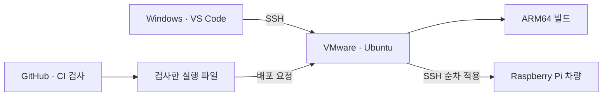
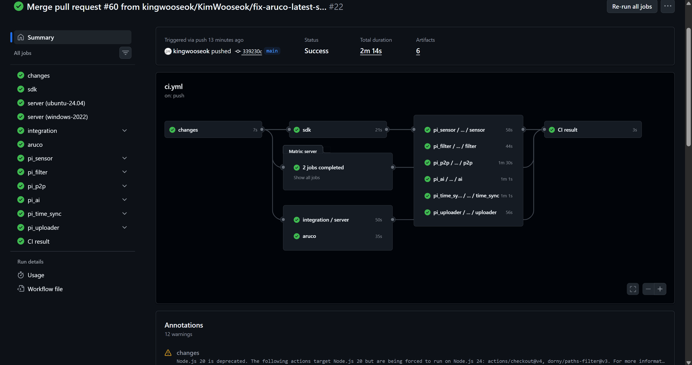
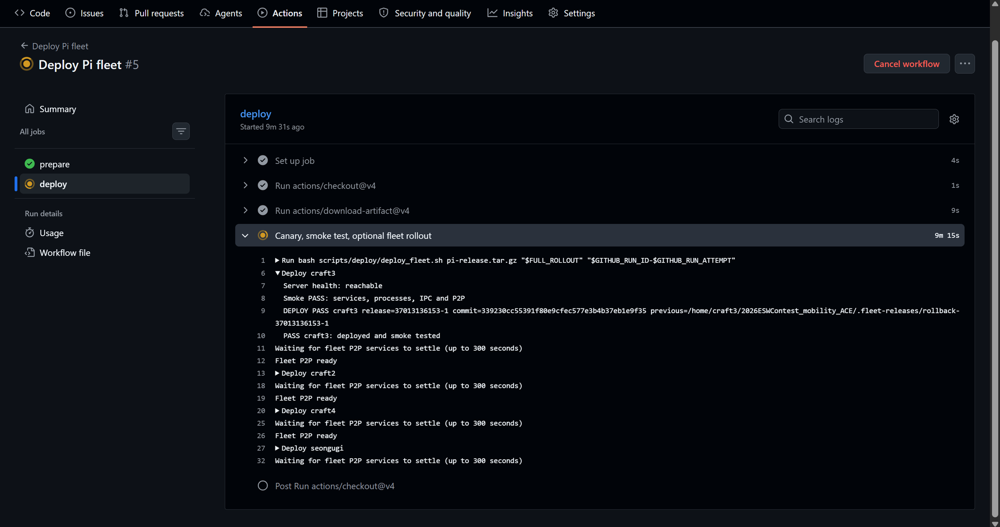

# 설치 · 빌드 · CI/CD

**Ubuntu에서 Pi용 실행 파일을 만들고, GitHub Actions로 검사한 뒤 차량에 순서대로 배포합니다.**

[자동 검사](#ci-자동-검사) · [첫 설치](#첫-설치와-빌드) · [서비스 등록](#pi-서비스-등록) · [평상시 배포](#평상시-배포) · [최초 배포 준비](#최초-배포-준비) · [실패 시 복원](#실패-시-복원)



| 실행 위치 | 담당 작업 |
|---|---|
| Windows | [ArUco 추적·BLE 전송](../aruco_BLE_(IN_windowsPC)/README.md), [촬영 영상 박스 작업](../model_training/README.md) |
| Ubuntu 24.04 / VMware | SDK·크로스 빌드, self-hosted 배포 실행기 |
| Raspberry Pi OS Lite 64-bit | 센서·통신·필터·AI·업로더 서비스 |
| GitHub Actions | 자동 검사, Pi용 실행 파일 보관, 수동 배포 요청 |

## 개발한 코드를 장치까지 연결하는 방식

| 흐름 | 동작 | 얻는 효과 |
|---|---|---|
| 같은 SDK로 빌드 | Ubuntu 개발 환경과 CI가 같은 Pi용 라이브러리 사용 | 개발·자동 검사에 같은 빌드 기준 적용 |
| 검사한 파일 배포 | CI의 실행 파일과 같은 버전의 모델·서비스 설정 전달 | 코드와 장치 설정을 한 배포 단위로 관리 |
| 한 대 점검 후 순차 적용 | 서비스·IPC·P2P 상태를 점검하고 다음 차량으로 진행 | 장치별 배포 결과를 확인하며 적용 |
| 실패한 장치 복원 | 이전 실행 파일·설정·서비스 상태로 복원 | 저장된 영상과 업로드 큐를 이어서 사용 |

## CI 자동 검사

**README·문서만 변경하면 CI 실행 자체를 생략합니다. 코드 변경은 해당 모듈만 검사하며, 작성 중인 Draft PR은 Ready for review로 전환할 때 검사합니다.**

- Pi 모듈은 한 실행 환경에서 SDK·컴파일러를 한 번 준비하고 순차 빌드합니다. `main`에 Pi 코드가 변경되면 배포용 6개 실행 파일을 함께 만듭니다.
- 서버 변경은 Ubuntu·Windows에서 검사하고, 실제 FFmpeg 병합 검사는 Ubuntu 서버 작업에 포함합니다. ArUco 변경은 Windows 오프라인 검사만 실행합니다.
- 같은 PR·브랜치의 이전 실행은 새 변경이 올라오면 취소합니다. 패키지 설치·개별 시험은 3분, 서버·ArUco 작업은 10분, Pi 작업 전체는 20분 이내로 제한합니다.
- 배포용 실행 파일은 `main`에서만 업로드하고 3일간 보관합니다. PR에서는 빌드·시험을 수행합니다.

현재 `main`의 전체 배포용 파일이 필요하면 **Actions → CI → Run workflow**로 전체 검사를 실행합니다. 성공한 실행 ID를 배포 요청에 사용합니다. 배포는 현재 커밋과 일치하고 6개 Pi 결과물이 모두 있는 CI만 사용합니다.

[](../docs/assets/ci.png)

| 검사 대상 | 수행 내용 |
|---|---|
| Pi 6개 모듈 | ARM64 크로스 빌드, 센서 단위시험, 실행 파일·AI 런타임 경로 검사, cppcheck 로그 |
| Server · Ubuntu / Windows | 회귀시험, 앱 기동·DB·HTTP health·임시 인증서 HTTPS |
| ArUco / BLE · Windows | 문법·설정·프로토콜·추적·송신 오프라인 시험 |
| Server integration | Ubuntu 서버 검사에 포함된 업로드 계약·실제 FFmpeg 병합. 별도 수동 실행도 지원 |
| CI result | 선택된 검사 결과를 모아 최종 성공 여부 판정 |

SDK는 Release `v1.2`의 SHA-256을 검사한 뒤 캐시로 공유합니다. Pi 실행 파일은 `pi-<모듈>` artifact로 보관합니다. [CI 설정](../.github/workflows/ci.yml) · [통합 검사](../.github/workflows/integration.yml)

## 첫 설치와 빌드

**Ubuntu에서**, 저장소를 받은 뒤 실행합니다.

```bash
./scripts/setting/setup_host.sh
./scripts/setting/download_sdk.sh
source scripts/setting/setup_sdk.sh
make -C sensor
```

새 터미널에서는 `source scripts/setting/setup_sdk.sh`를 다시 실행합니다. SDK 다운로드에는 GitHub CLI 인증이 필요합니다.

**각 Pi에서**, 저장소를 받은 뒤 최초 한 번 실행합니다.

```bash
cd ~/2026ESWContest_mobility_ACE
sudo bash scripts/setting/setup_target.sh
```

| 빌드 대상 | 명령 | `test/`에 생성되는 파일 |
|---|---|---|
| Sensor | `make -C sensor` | `witness_aruco`, `accident_aruco` |
| P2P | `make -C p2p` | `broadcast_sender`, `broadcast_receiver`, `p2p_go.sh`, `p2p_client.sh` |
| Filter | `make -C filter` | `witness_filter` |
| AI | `make -C ai` | `inference`, `video_processor` |
| Time Sync | `make -C time_sync` | `time_sync` |
| Uploader | `make -C uploader` | `uploader` |

Pi에서 직접 빌드할 때는 SDK를 적용하지 않은 터미널을 사용합니다. 관측차 실행에는 `ai/vehicle_detector.onnx`를 준비합니다. [모델 배치 안내](../ai/README.md)

<details>
<summary>Host SDK와 Pi 최초 설치가 준비하는 항목</summary>

| 항목 | 구성 |
|---|---|
| 컴파일러 | Debian AArch64 GCC/G++ 14 + Release SDK sysroot |
| SDK | Release `v1.2`, SQLite 개발 파일·ARM 링크 검사, ONNX Runtime 1.29.0 |
| Pi 공통 | BlueZ·GLib·SQLite, libcamera·FFmpeg 개발 파일, libgpiod 2.x |
| 센서 역할 | `craft2`: `sensor@accident` / `craft3`·`craft4`·`seongugi`·`craft5`·`craft6`: `sensor@witness` |
| 기본 서비스 | 기존 Chrony 설정 유지, Bluetooth 활성화, 센서 부팅 등록 |
| 업로더 설정 | `uploader/deploy/uploader.env`에서 hostname별 차량·인증 적용. `seongugi`는 `CAR_05` |

Windows Bluetooth 설정을 열어 두면 노트북 `88:F4:DA:74:9E:14`와 최초 페어링을 시도합니다. Windows 승인창을 확인합니다. 검색 15초·페어링 최대 60초이며, 실패 시 나머지 설치 후 `BLE 등록 미완료`를 안내합니다. 설치를 다시 실행하면 재시도하고 기존 페어링은 재사용합니다. Pi는 `hci0` 단일 컨트롤러를 사용합니다.

ONNX Runtime은 `/opt/onnxruntime-linux-aarch64-1.29.0`에 설치하고 `/opt/onnxruntime`으로 연결합니다. 버전·ARM64 라이브러리·헤더·실행 검사를 통과한 기존 설치는 재사용합니다. 교체 전 설치는 `/opt/onnxruntime.backup.XXXXXX/runtime`에 보관하고 새 검사 실패 시 복원합니다.

센서 실행 파일이 이미 있으면 서비스를 시작하고, 없으면 빌드 후 해당 역할의 서비스를 시작합니다. 실행 중인 센서는 유지합니다. 새 Pi는 [wlan0 P2P 무선 준비](../p2p/README.md#새-pi의-무선-준비)도 적용합니다. `wlan1`은 서버 연결용입니다.

루트 Makefile은 새 C 모듈을 위한 예시이며, 실제 빌드는 각 모듈 Makefile을 사용합니다. [SDK 제작 설정](../toolchain/README.md)

</details>

## Pi 서비스 등록

실행 파일을 Pi의 `test/`에 배치한 뒤 **Pi 저장소 루트에서 아래 순서로** 실행합니다. 설치 명령은 부팅 등록과 즉시 시작을 함께 수행합니다.

| 순서 | 대상 | 명령 | 서비스 |
|---|---|---|---|
| 1 | 전체 | `sudo sh time_sync/deploy/install-service.sh` | `time_sync` |
| 2 | 전체 | `sudo sh uploader/deploy/install-service.sh` | `uploader` |
| 3 | 전체 | `sudo sh ai/deploy/install-service.sh` | 사고차 `video_processor` / 관측차 `inference` |
| 4 | 관측차 | `sudo sh filter/deploy/install-service.sh` | `witness_filter` |
| 5 | 전체 | `sudo sh p2p/deploy/install-service.sh` | 사고차 `p2p-go` / 관측차 `p2p-client` |

센서는 최초 설치에서 등록됩니다. 이후 부팅마다 자동 실행하며, 처리 스레드 정지는 각 모듈의 워치독과 systemd 재시작으로 복구합니다.

<details>
<summary>서비스 설정·저장 경로·수동 복사</summary>

- 설치 스크립트가 저장소 위치를 찾아 `test/` 실행 파일과 모듈별 `deploy/` 설정을 연결합니다.
- Time Sync 기본값: `time_sync/deploy/time_sync.env`, 측정 주기 1000ms·offset 기준 100ms.
- Uploader 데이터: `$HOME/uploader/data/queue.db`, `$HOME/uploader/data/jobs`.
- 서버 AP 연결을 기다리지 않고 로컬 서비스를 시작합니다. 늦게 열린 IPC는 각 모듈이 다시 연결합니다.
- 환경 파일을 바꾸면 해당 서비스를 재시작합니다. 실행 파일·unit을 바꾸면 빌드 후 설치 명령을 다시 실행합니다.
- 수동 실행 전에는 동일 서비스를 `sudo systemctl stop 서비스명`으로 중지합니다. 다시 사용할 때 `sudo systemctl start 서비스명`으로 시작합니다.

개별 파일만 보낼 때는 다음 도구를 사용합니다.

```bash
cd test
./deploy.sh
```

전송 파일·`사용자@IP`·대상 경로·비밀번호를 입력합니다. 마지막 실행 파일 선택에서 **Enter는 복사만**, 실행 파일을 지정하면 복사 후 실행합니다.

</details>

## 평상시 배포

**1. VMware에서 실행기를 켭니다.**

```bash
cd ~/actions-runner
./run.sh
```

`Listening for Jobs` 상태로 두면 GitHub의 배포 요청을 받아 실행합니다. 이미 대기 중인 요청이 있으면 바로 처리합니다.

**2. GitHub에서 배포를 요청합니다.**

| 화면 | 선택할 값 |
|---|---|
| Actions → CI | 현재 `main` 커밋의 성공한 `push` 실행 |
| `ci_run_id` | 위 실행 주소의 `/actions/runs/` 뒤 숫자 |
| Actions → Deploy Pi fleet → Run workflow | branch `main`, 해당 `ci_run_id` |
| `full_rollout` 끔 | craft3 한 대에 선행 배포 |
| `full_rollout` 켬 | craft3 통과 후 craft2 → craft4 → seongugi → craft6 순차 배포 |

**3. 각 장비의 `DEPLOY PASS`와 최종 실행 결과를 확인합니다.**


[](../docs/assets/deploy.png)

배포할 때는 **CI에서 검사한 실행 파일과 같은 버전의 설정·서비스 파일을 Pi에 적용**합니다. 실행 파일, `time_sync.env`, `uploader.env`, unit·설치 스크립트, 공개 CA, Git에 등록된 ONNX 모델을 반영합니다. 기존 영상과 업로드 큐는 계속 사용합니다.

<details>
<summary>배포 대기 시간과 점검 범위</summary>

서비스 재시작은 최대 60초, P2P 재시작과 장비 사이 전체 P2P 준비 대기는 각각 최대 300초입니다. 전체 차량의 P2P 서비스가 active이고 대기 job이 없는 상태를 연속 두 번 확인한 후 다음 장비로 갑니다. craft3만 배포하더라도 전체 5대의 P2P 준비를 확인합니다.

배포 직후 기본 동작 검사(smoke test)로 서비스·프로세스·IPC·P2P 상태를 확인합니다. 서버 연결 상태도 기록하며, 서버가 일시적으로 꺼져 있어도 Pi 배포는 진행합니다. 카메라·BLE·실제 사고 동작은 장비 시험으로 확인합니다.

</details>

## 최초 배포 준비

**노트북 실행기 등록 → 각 Pi 공개키 등록 → 배포 전용 권한 설치**를 한 번 수행합니다. Pi에는 위 최초 설치·서비스 등록을 마친 `$HOME/2026ESWContest_mobility_ACE` 저장소가 있어야 합니다.

<details>
<summary>1. GitHub 실행기 등록과 SSH 별칭</summary>

GitHub와 5대 Pi에 접속 가능한 Linux x64 환경을 사용합니다.

- Settings → Actions → Runners: self-hosted runner를 등록하고 `fleet`, `deploy` label을 추가합니다.
- Settings → Environments: `pi-fleet` 생성, 배포 branch를 `main`으로 지정합니다.
- 아래 키·SSH 설정은 **runner를 실행하는 계정**에 준비합니다. 여러 실행기가 있어도 배포는 한 번에 하나씩 진행합니다.

```bash
mkdir -p ~/.ssh
chmod 700 ~/.ssh
ssh-keygen -t ed25519 -f ~/.ssh/fleet_deploy -N "" -C "ace-deploy-$(hostname)"
```

`~/.ssh/config`에 다음을 추가합니다.

```sshconfig
Host craft2 craft3 craft4 seongugi craft6
    IdentityFile ~/.ssh/fleet_deploy
    IdentitiesOnly yes
Host craft2
    HostName 192.168.50.2
    User craft2
Host craft3
    HostName 192.168.50.3
    User craft3
Host craft4
    HostName 192.168.50.4
    User craft4
Host seongugi
    HostName 192.168.50.5
    User seongugi
Host craft6
    HostName 192.168.50.6
    User craft6
```

</details>

<details>
<summary>2. Pi에 공개키 등록</summary>

각 Pi의 호스트키를 확인하고 로그인 비밀번호를 입력합니다. 노트북마다 별도 키를 등록합니다.

```bash
chmod 600 ~/.ssh/config
for node in craft2 craft3 craft4 seongugi craft6; do
    ssh-copy-id -i ~/.ssh/fleet_deploy.pub "$node"
    ssh -o BatchMode=yes -o StrictHostKeyChecking=yes "$node" 'hostname -s'
done
```

</details>

<details>
<summary>3. Pi에 배포 프로그램과 전용 권한 설치</summary>

각 Pi 저장소 루트에서 실행합니다. 배포할 커밋의 파일을 설치합니다.

```bash
sudo install -d -m 0755 -o root -g root /usr/local/libexec
sudo install -m 0755 -o root -g root scripts/deploy/apply_release.sh /usr/local/libexec/ace-fleet-apply
sudo visudo -cf scripts/deploy/fleet-deploy.sudoers &&
sudo install -m 0440 -o root -g root scripts/deploy/fleet-deploy.sudoers /etc/sudoers.d/fleet-deploy
sudo visudo -cf /etc/sudoers.d/fleet-deploy
```

`parsed OK`를 확인합니다. 배포 계정은 root 소유의 `/usr/local/libexec/ace-fleet-apply`만 비밀번호 없이 호출합니다. 이 프로그램이 변경될 때는 위 설치를 다시 수행합니다. 배포 시작 시 해당 커밋과 설치된 프로그램의 해시·실행 권한을 대조합니다.

</details>

## 실패 시 복원

**파일 적용이나 기본 동작 검사 실패 → 해당 Pi의 이전 배포 복원 → 다음 차량 배포 중단** 순서로 처리합니다.

| 확인할 것 | 위치·의미 |
|---|---|
| `ROLLBACK PASS` / `ROLLBACK FAILED` | 해당 Pi 복원 결과 |
| 복원 대상 | 실행 파일·설정·모델·unit·공개 CA·서비스 실행 및 부팅 활성 상태 |
| 배포별 백업 | `.fleet-releases/rollback-<run_id>-<run_attempt>/` |
| 마지막 성공 배포의 직전 버전 | `.fleet-releases/previous` |

전체 P2P 준비 대기에서 멈췄다면 장비별 서비스 상태를 로그로 확인합니다. 이 대기는 적용·smoke 이후 단계이므로 이미 성공한 장비를 자동으로 되돌리지는 않습니다.

[배포 흐름 코드](deploy/deploy_fleet.sh) · [장비 적용·복원 코드](deploy/apply_release.sh) · [SDK 제작](../toolchain/README.md) · [프로젝트 소개](../README.md)
