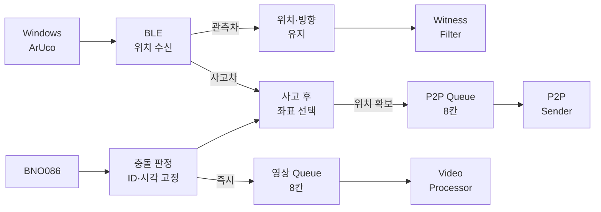
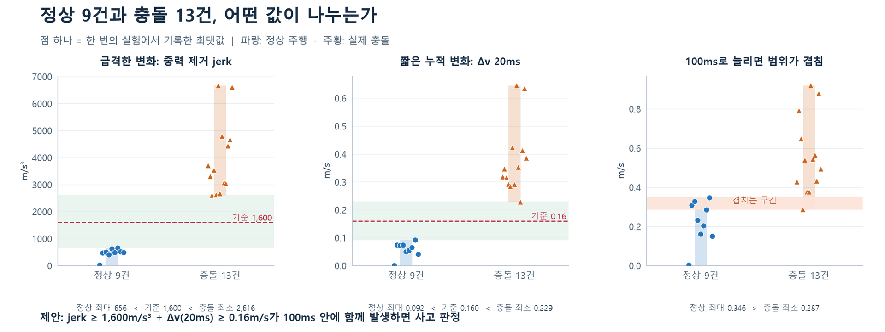

# Sensor — ArUco 위치 수신과 IMU 사고 감지

**IMU로 사고를 감지하면 즉시 자체 영상을 요청하고, 사고 후 처음 확보한 좌표로 주변 차량에 사고를 알립니다.** 관측차에는 ArUco에서 측정한 위치와 카메라 방향을 전달해 영상 선별의 기준을 제공합니다.

[전체 흐름](../README.md) · [위치·화각 선별](../filter/README.md) · [영상 보존](../ai/README.md) · [IMU 측정 자료](../docs/measurements/README.md#imu-사고-판정)



## 역할과 입출력

| 실행 파일 | 입력 | 출력 |
|---|---|---|
| `witness_aruco` | 해당 차량의 BLE 위치·방향 | `/tmp/witness_sensor.sock` → Filter |
| `accident_aruco` | BLE 위치 + BNO086 Raw/Linear 가속도 | `/tmp/p2p.sock` + `/tmp/video_processor_event.sock` |

관측차는 자신의 위치와 카메라 방향을 최대 초당 20회 Filter에 전달합니다.

## Jerk와 속도 변화량을 함께 보는 사고 판정

**22회 시험에서 수집한 가속도 파형을 비교해 jerk와 delta-V의 기준을 정했습니다.** Jerk는 가속도가 얼마나 급하게 변했는지, delta-V는 짧은 시간 동안 속도가 얼마나 변했는지를 나타냅니다.

[](../docs/measurements/README.md#imu-사고-판정)

정상 주행 9건과 충돌 13건의 기록을 실제 C 판정 함수에 다시 입력한 결과, **정상 오탐 0건·충돌 검출 13건**이었습니다. 두 지표가 100ms 안에 함께 기준을 넘으면 사고를 확정합니다.

| 항목 | 현재 설정 |
|---|---|
| 판정 활성화 | `enabled = true` |
| 결합 조건 | Linear jerk **1,600m/s³** + Linear delta-V **0.16m/s**, 두 지표 모두 충족 |
| delta-V 적분창 / 결합 시간 | 20ms / 100ms |
| Cooldown / quiet rearm | 2,000ms / 1,000ms |

설정 위치: [`accident_aruco.c`](accident_aruco.c)의 `collision_config`.

## 자체 영상 보존과 주변 차량 알림

1. IMU가 사고를 감지하면 사고 ID·시각을 기록하고, 자체 영상을 보존할 요청을 즉시 대기열에 넣습니다.
2. **사고 후 처음 확보한 좌표**를 사고 위치로 선택합니다.
3. 확정 좌표를 같은 사고 ID·시각과 함께 P2P Queue에 등록합니다. 이후 차량이 이동해도 사고 좌표는 바뀌지 않습니다.

**위치 수신을 기다리는 동안에도 자체 영상 보존은 진행합니다.**

영상·P2P 대기열은 각각 8칸으로 운영하며 실패한 전송만 다시 시도합니다. 대기열이 가득 차면 요청과 사고 ID·시각을 보관했다가 빈 공간에 등록합니다.

## 프로세스에 전달하는 정보

| 대상 | 메시지 / payload | 시각 |
|---|---|---|
| Filter | `IPC_MSG_SENSOR_DATA` / `vehicle_state_t` | 마지막 정상 위치의 Pi monotonic ns |
| P2P Sender | `IPC_MSG_ACCIDENT_EVENT` / `accident_ipc_event_t` | 원본 사고 시각, ITS epoch ms |
| Video Processor | `IPC_MSG_VIDEO_PROCESSOR_EVENT` / `video_processor_event_t` | P2P와 같은 사고 시각, ITS epoch ms |

X/Y는 mm입니다. 관측차 heading은 도, 사고차 `heading_value`는 0.1도 단위이며 +Y=0°·+X=90°를 사용합니다. 사고차는 사고 생성 시 `station_id=1`, `sequence_number=1..65535`를 확정해 두 경로에서 재사용합니다. 순번은 사고 생성마다 증가·순환하며 위치 대기나 송신 재시도 중에는 바뀌지 않습니다. 영상 payload는 좌표 없이 ID·시각을 전달합니다. IPC header에는 IMU event의 monotonic 시각을 보존합니다. [공용 IPC](../ipc/README.md)

## 실행 지속과 복구

| 상황 | 처리 |
|---|---|
| 관측차 마커 소실·BLE 단절 | 확보한 정상 위치·방향과 원래 측정 시각 유지 |
| BNO reset·Raw/Linear 2초 무수신 | I/O 스레드가 startup·report 설정 재시도; 실제 수신과 주기 확인 후 판정 재개 |
| BNO 복구 | 새 generation부터 jerk·delta-V 계산 재개; 이미 판정한 사고는 보존 |
| 사고 위치 미확보 | P2P 전송 생략; 자신의 영상 요청과 재시도 유지 |
| P2P·영상 프로세스 연결 실패 | IMU 처리를 계속하며 대상별 IPC 재연결 |
| BLE·IMU·판정·송신 스레드 정지 | 진행 watchdog → systemd 센서 서비스 재시작 |

## 빠른 시작

Pi 저장소 루트에서 최초 환경을 설치하고 빌드합니다.

```bash
sudo bash scripts/setting/setup_target.sh
make -C sensor
sudo systemctl start sensor@accident
```

관측차의 마지막 명령은 `sudo systemctl start sensor@witness`입니다. 공통 설치가 BlueZ·BLE 페어링과 hostname별 부팅 서비스를 준비합니다. 실행 파일은 `test/`에 생성됩니다.

| hostname | 역할·서비스 | BLE ID / 광고 |
|---|---|---|
| `craft2` | 사고차 · `sensor@accident` | 1 / ACE1 |
| `craft3` | 관측차 · `sensor@witness` | 2 / ACE2 |
| `craft4` | 관측차 · `sensor@witness` | 3 / ACE3 |
| `seongugi` 또는 `craft5` | 관측차 · `sensor@witness` | 4 / ACE4 |
| `craft6` | 관측차 · `sensor@witness` | 5 / ACE5 |

## 상세 설정과 계측

<details>
<summary>수동 실행·BLE ID·로그 확인</summary>

터미널에서 직접 시험할 때는 먼저 해당 Pi의 센서 서비스를 중지한 뒤 프로젝트의 `test/`에서 실행한다.

```bash
cd ~/2026ESWContest_mobility_ACE/test
# 사고차 craft2
sudo systemctl stop sensor@accident
sudo ./accident_aruco
```

관측차에서는 `sudo systemctl stop sensor@witness` 후 `sudo ./witness_aruco`를 실행한다. 시험을 마치면 `Ctrl+C`로 종료하고 해당 역할의 `systemctl start` 명령으로 서비스를 다시 시작한다.

수동 옵션은 hostname과 공통 기본값보다 우선한다. 다른 노트북이나 별도 시험 차량에서는 필요한 옵션만 지정한다.

```bash
sudo ./witness_aruco --vehicle-id 2 --peer AA:BB:CC:DD:EE:FF --adapter hci0 --stale-ms 300
```

`--vehicle-id` 범위는 1..65535, `--stale-ms` 범위는 50..1000ms다. 모르는 hostname은 `--vehicle-id`를 지정한다. 알려진 hostname에서 다른 역할을 수동 시험할 때도 `--vehicle-id`를 명시한다. 옵션 없이 역할이 다른 실행 파일을 선택하면 맞는 실행 파일을 안내하고 종료한다. `--help`는 사용법을 출력한다.

기본 hostname 표와 peer 주소는 `aruco_receiver.c`의 `receiver_resolve_vehicle_id()`와 `ARUCO_DEFAULT_PEER_ADDRESS`에 있다. 기본 IPC 경로는 관측차 `/tmp/witness_sensor.sock`, 사고차 `/tmp/p2p.sock`과 `/tmp/video_processor_event.sock`이다. 상대 프로세스가 나중에 시작해도 재연결하여 전달한다.

```bash
systemctl status sensor@accident
journalctl -u sensor@accident -f
```

관측차는 서비스 이름을 `sensor@witness`로 바꾼다. 기본 adapter는 `hci0`, peer는 `88:F4:DA:74:9E:14`, 유효기간은 300ms다.

</details>

<details>
<summary>BLE 페어링·보안·40바이트 Pose/Clock 규약</summary>

### PC 페어링과 연결

최초 설치 때 노트북의 Windows Bluetooth 설정 화면을 열어 둔다. `setup_target.sh`가 기본 PC `88:F4:DA:74:9E:14`를 검색해 페어링을 요청하고 trust까지 등록한다. Windows 승인창이 뜨면 한 번 확인한다. Pi의 `hci0` 단일 컨트롤러에서 진행하며, 기존 페어링은 재사용한다. 등록이 끝나지 않으면 설치 마지막에 `BLE 등록 미완료`를 표시한다. Windows 설정을 확인한 뒤 설치를 다시 실행한다.

페어링·trust 기록은 재부팅 후에도 유지된다. 이후에는 Pi의 센서 서비스가 부팅 때 수신을 준비하고 Windows 송신 프로그램이 차량별 BLE 연결을 맺는다.

Windows는 Central/GATT client, 각 Pi는 Peripheral/GATT server다. PC에는 차량별 연결 객체를 하나씩 유지하고 각 연결에 별도 송신 작업을 둔다. 같은 PC 주소를 각 Pi에 허용하고 hostname 표의 서로 다른 BLE ID를 사용한다. 광고 이름은 `ACE1`, `ACE5`처럼 ID를 포함한다. 수동 설정에서도 차량별 ID를 맞춘다. PC가 privacy address를 사용한다면 **페어링 후 BlueZ가 식별한 identity address**를 `--peer`에 지정한다.

수신부는 BlueZ가 호출한 요청인지, 지정한 adapter/PC에서 온 것인지, 그 PC가 Paired/Trusted/Connected 상태인지 검사한다. characteristic은 암호화된 read/write를 요구한다.

### GATT와 Windows 송신 규약

| 대상 | UUID | 동작 |
|---|---|---|
| Service | `7b9c0001-6a54-4f1b-9f65-2c7b8d1e4a90` | 차량 수신 서비스 |
| Pose | `7b9c0002-6a54-4f1b-9f65-2c7b8d1e4a90` | 40바이트 Write with response |
| Clock | `7b9c0003-6a54-4f1b-9f65-2c7b8d1e4a90` | 20바이트 Read |

Pose는 40바이트를 하나의 ATT Write with response로 보낸다. **협상 MTU는 최소 43이다.** PC에서는 Bleak의 `write_gatt_char(..., response=True)`를 사용한다. 수신부는 offset이 있는 쓰기, 잘못된 크기, write without response와 long/reliable/prepare write를 거부한다.

Clock 응답은 little-endian `struct.pack('<4sQQ', ...)`에 해당한다.

| Offset | 크기 | 값 |
|---|---|---|
| 0 | 4 | ASCII `ACT1` |
| 4 | 8 | Pi가 생성한 session epoch |
| 12 | 8 | 응답 생성 시 Pi CLOCK_MONOTONIC ns |

PC와 Pi의 monotonic 시계는 기준점이 다르므로 바로 뺄 수 없다. PC는 clock read 직전/직후의 `perf_counter_ns()`를 `t0`, `t1`으로 기록한다. 응답의 Pi 시각을 `T`라 하면, 간단하고 보수적인 환산값은 `offset = T - t1 - 1_000_000`이다. PC 프레임의 촬영 시각에 이 offset을 더해 `capture_ns`로 전송한다. 이 방식은 read 응답 편도 지연과 1ms 여유만큼 시각을 과거로 잡아 미래 시각으로 잘못 보내는 것을 줄인다.

PC 송신부는 시작 시 여러 번 Clock을 읽어 왕복시간이 가장 짧은 응답을 선택한다. RTT가 100ms를 넘는 샘플은 버리고, 운행 중에는 10초마다 갱신한다. `capture_ns`에는 영상 프레임을 꺼낸 원래 시각을 환산해 넣는다. 촬영부터 프레임을 꺼내기까지의 버퍼 지연은 이 시각보다 앞에 포함된다.

Pose는 아래 40바이트 배치에 맞춰 little-endian으로 직렬화한다.

| Offset | 크기 | 필드 | 의미 |
|---|---|---|---|
| 0 | 4 | magic | ASCII `ACP1` |
| 4 | 2 | vehicle_id | 해당 Pi의 `--vehicle-id` |
| 6 | 2 | flags | bit0=이번 프레임 검출 성공, 나머지 0 |
| 8 | 8 | epoch | Clock에서 받은 session epoch |
| 16 | 4 | sequence | 차량별 write 시도마다 증가, uint32 wrap 허용 |
| 20 | 8 | capture_ns | Pi CLOCK_MONOTONIC 기준으로 환산한 촬영 시각 |
| 28 | 4 | x_mm | signed int32, 테스트베드 X mm |
| 32 | 4 | y_mm | signed int32, 테스트베드 Y mm |
| 36 | 2 | heading_cdeg | 0..35999, 1단위=0.01도 |
| 38 | 2 | reserved | 0 |

Python 송신 payload 형식:

```python
payload = struct.pack(
    '<4sHHQIQiiHH', b'ACP1', vehicle_id, int(tracking_valid),
    epoch, sequence, capture_pi_ns, x_mm, y_mm, heading_cdeg, 0,
)
await client.write_gatt_char(POSE_UUID, payload, response=True)
```

좌표 원점/축과 마커 높이·장착각 보정은 Windows에서 적용한다. 방향은 **0도=+Y, 90도=+X**다. 관측차 heading은 블랙박스 카메라 중심 방향, 사고차 heading은 차량 방향이다. 수신부는 X/Y 범위 ±1,000,000mm와 heading 범위 0..35999 cdeg를 허용한다.

### 누락·지연·재연결 처리

| 위치 처리 설정 | 값 |
|---|---|
| 위치 수신 유효기간 | 300ms |
| 사고 좌표 선택 | 사고 후 처음 확보한 좌표 |
| 카메라 시각 보정 | `camera_read_delay_ms = 357`ms |

- 새 패킷의 순번과 촬영 시각이 모두 전진해야 한다. 중복이나 역순 패킷은 최신 상태를 갱신하지 않는다.
- 위치 유효기간은 **촬영 시각부터** 계산한다. Pi monotonic 기준으로 나이가 0~300ms 미만인 관측을 사용한다. 만료·중복·역순 패킷은 정상 GATT 응답으로 수신 처리를 마치고 연결을 유지한다. 만료된 새 순번은 위치를 무효로 만들며, 중복·역순 패킷은 기존 위치를 덮어쓰지 않는다.
- 마커를 못 찾았으면 새 프레임 순번/시각에 `flags=0`을 보낸다. 이때 좌표와 방향을 0으로 채워도 된다. 이전 검출 좌표에 새 시각을 붙여 정상 패킷으로 반복하지 않는다.
- 차량마다 최신 프레임 하나만 보관하여 송신 적체를 방지한다. 끊어진 동안 쌓인 프레임은 재연결 후 폐기한다.
- 연결/보안 상태 상실, adapter loss, BlueZ 재시작 시 위치를 무효화하고 epoch를 바꾼다. PC는 다시 Clock을 읽어 시간 환산값을 얻고 최신 프레임부터 재개한다. Clock 읽기 자체는 epoch를 바꾸지 않는다. 같은 epoch에서는 순번을 이어가며 epoch가 바뀌었을 때만 초기화한다.
- BlueZ/adapter가 돌아오면 서비스 재등록을 시도한다. system D-Bus 연결이 끊기면 수신부가 종료 절차를 거쳐 실패 상태로 종료하고, systemd가 센서 서비스를 다시 시작한다.
- 관찰차는 최초 정상 위치를 확보한 뒤 고정 배치 위치를 최대 20Hz로 IPC 전송한다. 마커 소실·좌표 만료·BLE 단절 동안에도 마지막 정상 위치와 카메라 방향을 유지한다. `witness_filter`도 정상 위치를 보관하므로 센서나 IPC가 중단되어도 고정 배치의 관측 판정을 계속한다.
- 사고차는 사고 후 처음 확보한 좌표를 사고 위치로 사용한다.

</details>

<details>
<summary>고정 관측차 위치 유지</summary>

`witness_aruco`는 고정 배치한 관측차의 위치와 카메라 방향을 제공한다. 최초 정상 측정의 X/Y·방향·원래 `capture_ns`를 저장한 뒤 IPC를 시작하고, 새 정상 측정으로 갱신한다.

정상 좌표가 한 번 저장된 뒤에는 같은 프레임이 반복되거나 마커가 사라져도 최대 20Hz로 고정 위치를 전달한다. BLE 단절이나 IPC 송신 실패도 저장값을 지우지 않는다. IPC가 끊기면 기존 0.5초 재연결 간격을 적용한다. 새로운 측정은 송신 주기 제한 중에도 저장하여 다음 전송에 사용한다.

`vehicle_state_t.detection_time`과 IPC header timestamp는 마지막 정상 측정의 원래 Pi CLOCK_MONOTONIC ns이며, IPC sequence만 성공한 전송마다 증가한다. Filter는 최초 정상 위치를 확보할 때까지 먼저 도착한 사고를 보관하고, 이후에는 수신 간격으로 위치를 만료시키지 않는다. 센서만 재시작하면 Filter의 기존 위치는 남고, Filter도 재시작하면 정상 위치를 다시 기다린다. 최초 확보·유지 진입·정상 재수신은 `[WITNESS]` 로그로 표시한다.

관측차 위치 캐시는 각 프로세스의 RAM에 저장된다. `witness_aruco`가 재시작하면 새 정상 측정부터 IPC를 재개한다. 관측차나 카메라 방향을 옮겼다면 재검출된 새 값으로 갱신한 뒤 사용한다.

</details>

<details>
<summary>BNO 배선·report·스레드 소유권·복구</summary>

`witness_aruco`에는 연결 센서가 필요 없다. `accident_aruco`, 실제 수집 mode의 `test_collision_capture`, BNO 하드웨어 진단 도구는 BNO086에 접근한다. **같은 BNO를 사용하는 프로세스는 하나만 실행한다.** 자료 수집 또는 진단 전에 `sudo systemctl stop sensor@accident`로 사고차 서비스를 중지한다. 수동으로 실행 중인 `accident_aruco`도 종료한다.

| 항목 | 기본값 |
|---|---|
| I2C device | `/dev/i2c-1` |
| I2C address | `0x4B` |
| GPIO chip | `/dev/gpiochip0` |
| H_INTN | GPIO line 18, active-low 입력 |
| Reset | GPIO line 23, active-low 출력 |

GPIO 설정에는 GPIO chip/line 번호를 쓴다. 보드 배치에 맞춰 `bno086_default_config()`의 설정을 적용한다.

### BNO report 설정

`accident_aruco`는 충돌 판정에 Raw/Linear Acceleration을 사용한다. `test_collision_capture`는 Raw/Linear Acceleration과 RV/Gyro/Mag를 설정하고 dynamic calibration을 수행한다.

| Report | `accident_aruco` runtime | `test_collision_capture` 수집기 |
|---|---|---|
| Accelerometer (중력 포함, Raw) | 10,000 us 요청 / 약 100 Hz | 10,000 us 요청 / 약 100 Hz |
| Linear Acceleration | 10,000 us 요청 / 약 100 Hz | 10,000 us 요청 / 약 100 Hz |
| Rotation Vector | 사용하지 않음 | 10,000 us 요청 / 약 100 Hz |
| Gyroscope | 사용하지 않음 | 10,000 us 요청 / 약 100 Hz |
| Magnetometer | 사용하지 않음 | 20,000 us 요청 / 약 50 Hz |

SH-2가 요청 주기를 지원 가능한 값으로 조정할 수 있다. FC 응답의 실제 interval이 non-zero이고 실제 Channel 3/4 report까지 수신되어야 feature 설정 성공으로 처리한다. Jerk/delta-V는 확인된 Raw/Linear interval을 사용한다. 수집 CSV에는 Raw/Linear Acceleration과 Gyro를 기록하며, 추가 RV/Mag는 수집기의 센서 부하·보정 조건에 영향을 준다.

임계값을 정할 때 실제 report interval, sample 누락, stale, 센서 포화를 함께 확인한다. 수집 자료에서 후보값을 정한 뒤, 가속도 전용 runtime의 report·보정 조건에 맞춰 적용한다.

### BNO 데이터 공유와 thread 소유권

| 자원 / 처리 | 소유 thread | 다른 thread와의 공유 |
|---|---|---|
| BNO I2C/GPIO, startup, feature 설정, packet drain | BNO I/O thread | Snapshot과 Event Ring |
| 최신 ArUco X/Y/heading, 촬영/만료 시각 | BLE main thread | Mutex로 보호한 위치 사본 |
| 충돌 evidence·latch, 대기 사고 한 건과 확정 payload | Collision thread | BNO Event Ring의 독립 cursor 사용; 영상 요청 즉시 등록, 위치 확보 후 P2P 등록 |
| P2P·Video Processor socket 재연결/송신 | IPC Sender thread | 대상별 최대 8개 요청의 bounded queue, 성공한 대상은 재전송하지 않음 |

드라이버의 Snapshot은 report별 최신 값 한 벌이다. Event Ring은 sample 순서를 보존하는 SPMC 구조이며, 충돌 thread는 Raw/Linear Acceleration을 독립 cursor로 순서대로 읽는다. Jerk와 delta-V 계산에서 중간 sample을 임의로 건너뛰면 안 된다.

Ring 포화로 cursor가 자료를 놓치면 `dropped`가 증가한다. Sequence gap, BNO reset/startup 경계의 `bno_generation` 변경이나 시각 역전에서는 이전 jerk/delta-V/evidence를 이어 쓰지 않는다. ArUco 위치 갱신·소실은 이 IMU 판정 상태를 초기화하지 않는다. BNO 단절로 detector가 재초기화되어도 이미 판정하여 보관한 사고는 남긴다.

### 실행 중 BNO 재시작 복구

BNO I/O thread가 startup 상실, generation 변경 또는 Raw/Linear 중 하나의 report가 2초 동안 갱신되지 않는 상황을 감지하면 준비 상태를 내리고 `begin → Raw Acceleration 설정/실제 report → Linear Acceleration 설정/실제 report`를 다시 수행한다. 실패하면 0.5초 간격으로 재시도하며 `[BNO]` 로그에 복구 상태를 표시한다. 종료 요청이 들어오면 재시도를 끝낸다.

Raw/Linear 수신 시각은 각각 감시하며, 새 세션의 대기 시간은 설정 완료 시각부터 계산한다. 복구 완료 시 새 generation, 실제 Raw/Linear interval과 완료 monotonic 시각을 함께 공개한다. Collision thread는 새 interval로 jerk·delta-V 계산을 초기화하고 복구 완료 이후 해당 generation의 sample부터 사용한다. 복구 중 들어온 sample과 이전 구간의 evidence는 제외한다. 이미 보관한 사고의 `detection_time`, 사고 monotonic 시각과 확보한 위치는 그대로 유지한다.

P2P나 Video Processor가 없거나 느려도 BNO sample 소비와 다른 대상의 송신은 계속한다. 대상의 queue가 가득 차면 대기 payload를 유지하고 빈 공간이 생길 때 등록한다. 위치 대기가 끝나도 아직 등록하지 못한 영상 요청은 남긴다. `SIGINT`/`SIGTERM`으로 종료하면 worker를 중지하고 join한 뒤 장치와 mutex를 정리한다.

</details>

<details>
<summary>충돌 지표·임계값 조정</summary>

여기서 Raw Acceleration은 중력을 포함한 Accelerometer 값이고, Linear Acceleration은 SH-2가 중력을 제거한 값이다.

| 지표 | 단위 | 계산 의미 |
|---|---:|---|
| Raw Acceleration | m/s² | 중력을 포함한 가속도 벡터 크기 |
| Linear Acceleration | m/s² | 중력을 제외한 가속도 벡터 크기 |
| Raw Jerk | m/s³ | 연속 Raw 벡터 차이의 크기 / 실제 report interval |
| Linear Jerk | m/s³ | 연속 Linear 벡터 차이의 크기 / 실제 report interval |
| Linear delta-V | m/s | 짧은 시간창에서 Linear 벡터를 사다리꼴 적분한 변화량의 크기 |

`metric_mask`로 선택한 지표 중 `minimum_evidence_count`개 이상이 `coincidence_window_ms` 안에서 함께 임계값에 도달하면 충돌 후보가 된다. 검출 시 latch하여 같은 충격의 여러 peak를 사고 한 건으로 묶는다. 다음 사고를 받으려면 cooldown이 끝나고 추가 evidence가 없는 quiet 시간도 지나야 한다. 사고 판정 즉시 영상 요청을 등록하고, 사고 후 처음 확보한 좌표로 P2P 요청을 등록한다. 앞선 사고가 대기 중이면 새 충격으로 별도 사고를 추가하지 않는다.

`collision_config`에서 사용할 `COLLISION_METRIC_*`, `minimum_evidence_count`, 각 임계값과 coincidence/cooldown/quiet 시간을 설정한다. delta-V 적분창은 20/50/100/200ms 중 선택한다. 실측 CSV와 파형을 검토해 값을 반영한 뒤 `make -C sensor`와 `make -C sensor check`로 빌드·회귀시험한다.

</details>

<details>
<summary>정상 주행·충돌 수집, 승인과 CSV</summary>

`test_collision_capture.c`는 BNO086의 정상 주행·충돌 자료를 기록하고 임계값 후보를 계산하는 계측 프로그램이다. 기록한 trial은 사용자가 채택·재분류·폐기한다.

### 빌드와 self-test

```bash
make test_collision_capture
./test_collision_capture --self-test
```

독립 컴파일도 가능하다.

```bash
gcc -std=c11 -Wall -Wextra -Wpedantic -Wshadow -Wconversion -Werror \
    -I. test_collision_capture.c bno086.c -pthread -lm \
    -o test_collision_capture
```

`--self-test`는 계산, sequence gap 처리와 CSV 파싱을 검사한다.

### 실제 수집 session

BNO를 사용하는 다른 프로세스를 종료한 뒤 실행한다.

```bash
sudo ./test_collision_capture --session rc_test_01
```

같은 session 이름을 다시 사용하면 기존 `summary.csv`를 읽어 이어서 수집한다. 메뉴에서 정상 주행 또는 충돌 trial을 선택한다.

- 정상 주행 조건: 정지/공회전, 일정 속도 직진, 정상 가속, 정상/급제동, 선회, 턱/요철 통과.
- 충돌 계획 방향: 전방, 후방, 좌측, 우측, 대각선. 실제 방향은 기록 후 다시 확인한다.

기록 중 명령은 다음과 같다.

| 입력 | 동작 |
|---|---|
| `Enter` | 현재 trial 기록 종료 |
| `m` + Enter | 실제 충돌 순간을 수동 표시하고 기록 계속 |
| `q` + Enter | 현재 trial 취소 |

### 결과 검토·약한 충돌·폐기

기록이 끝나면 peak 시각, 수동 marker, 종료까지 남은 시간(`end_before`), 진단값과 실제 주행 결과를 확인한다. 충돌 후 차량을 잡거나 들어 올린 동작의 spike가 섞였으면 승인하지 않는다.

| 입력 | 의미 |
|---|---|
| `k` | 현재 분류로 승인하고 저장 |
| `l` | 실제 outcome 또는 충돌 방향 재분류 |
| `w` | 약한 충돌/스침을 `non_accident_contact`로 승인 |
| `i` | 조종 실수나 시험 실패를 `invalid`로 보관 |
| `d` | 현재 trial을 완전히 폐기하여 저장하지 않음 |
| `r` | 폐기하고 같은 계획으로 즉시 다시 시험 |
| `q` | 현재 trial을 폐기하고 프로그램 종료 |

`w`로 승인한 약한 접촉은 실제 충돌 positive 집합에서 제외하고 정상 주행과 함께 **비사고 경계 자료**로 비교한다. `i` 및 technical-invalid 자료는 보관할 수 있지만 threshold 후보 계산에서 제외한다. 사용자가 계획한 방향과 실제 결과가 다르면 `l`로 바로잡고 시험 메모를 남긴다.

### CSV와 후보값의 수동 반영

결과는 실행 디렉터리 기준 `collision_captures/<session>/`에 저장한다.

| 파일 | 내용 |
|---|---|
| `summary.csv` | 승인 trial의 계획/실제 분류, 방향, 품질, peak 지표, interval, 누락·오류 진단과 메모 |
| `trial_000001.csv` 등 | 승인한 각 trial의 Raw/Linear/Gyro sample과 시간 정보 |

승인한 trial만 CSV에 저장한다. `collision_captures/`는 기본 Git 추적에서 제외된다.

Session summary는 유효한 정상 주행과 약한 접촉의 최대값을 실제 충돌의 최소값과 비교한다. 충분한 trial/조건/방향이 있고 두 집합이 분리되는 지표에만 수동 검토용 중간값 후보를 출력한다. `OVERLAP`이면 해당 지표의 후보를 제시하지 않는다.

기본 후보 표시 조건은 정상 주행 6개 이상, 서로 다른 정상 조건 6개, 충돌 방향 4개, 각 방향 2개다. `--min-normal`, `--min-normal-conditions`, `--min-directions`, `--min-per-direction`으로 조절할 수 있다. `--max-duration`의 기본 trial 제한은 300초이며, 전체 옵션은 `./test_collision_capture --help`로 확인한다.

팀이 `summary.csv`, 각 trial 파형, 시험 메모와 후보값을 함께 검토한 뒤 `accident_aruco.c`의 `collision_config`로 수동 반영한다. 적용 전 수집기와 가속도 전용 runtime의 rate·calibration·sample 누락 차이를 다시 확인한다.

</details>

<details>
<summary>회귀시험·BNO 하드웨어 진단</summary>

| 명령 | 범위 |
|---|---|
| `make` / `make all` / `make aruco` | 프로젝트 `test/`에 `witness_aruco`, `accident_aruco` 빌드 |
| `make test_collision_capture` | 독립 BNO 실측 수집기 빌드 |
| `make check` / `make check-c` | 수신·충돌·BNO·수집기 전체 회귀시험 |
| `make check-aruco` | ArUco packet/시간/IPC, 사고차 충돌·외부 위치, 모의 BlueZ BLE |
| `make check-bno` | BNO mock 7개 + 확장 mock 37개 |
| `make check-capture` | IMU 실측 수집기 self-test |
| `make bno-test-hw` | 실제 BNO 진단 실행 파일을 `/tmp`에 빌드 |

회귀시험 파일:

| 파일 | 검사 항목 |
|---|---|
| `test/test_aruco_receiver.c` | 바이트 규약 3그룹 + 고정 관측차 IPC 4그룹: 최초 측정, 주기 전송·시각 보존, 소실·재검출, 송신 실패·재연결·재시작 |
| `test/test_accident_aruco.c` | 임계값 비활성, latch/rearm, delta-V, gap/reset, 위치·P2P payload, 즉시 영상 요청·위치 실패 보존·동일 ID/시각·대상별 송신 실패와 queue 포화 재시도 |
| `test/test_aruco_ble.c` | private D-Bus에서 GATT·광고·암호화 요구·peer 권한·재등록 검증 |
| `test/test_bno086.c` | 기본 mock 7개와 실기기 feature/stability/accel 진단; 동적 보정 명령·event cursor도 검사 |
| `test/test_bno086_mock.c` | null 재시도 실패별 검사, FC enable/disable, sequence wrap·ring overrun 등 확장 mock 37개 |

BLE 회귀시험에는 GLib/GIO와 private test bus용 `dbus-daemon`이 필요하다. BNO 진단 도구는 다음 명령으로 실행한다.

```bash
make bno-test-hw

sudo /tmp/test_bno086_hw feature 10
sudo /tmp/test_bno086_hw stability 60
sudo /tmp/test_bno086_hw accel 30
```

- `feature 10`: feature 설정 race를 10회 반복한다.
- `stability 60`: RV/Gyro/Mag streaming을 60초 측정한다.
- `accel 30`: Raw/Linear Acceleration streaming을 30초 측정한다.

진단 출력의 주요 항목:

| 진단값 | 의미 |
|---|---|
| `syscall_bus_error_count` | Linux read/write/ioctl, NACK, timeout, short transfer 계열 |
| `shtp_validation_error_count` | continuation/channel/sequence/length protocol 불일치 |
| `phase2_null_count` | 정확히 `00 00 00 00`인 transient Phase-2 header 발생 횟수 |
| `phase2_null_retry_success` | null 직후 제한된 1회 재읽기로 정상 continuation 복구 |
| `phase2_null_retry_fail` | 재읽기에도 복구 실패 |

진단에는 BNO reset/startup loss/stale, Event Ring drop, 실제 report rate도 기록한다.

</details>

<details>
<summary>소스 찾기</summary>

| 파일 | 역할 |
|---|---|
| `witness_aruco.c` | 관찰차 main과 기존 filter IPC 변환 |
| `accident_aruco.c` | 사고차 main, BNO 가속도·충돌 판정, 사고 후 좌표 선택과 P2P·영상 IPC 송신 |
| `aruco_receiver.c`, `aruco_receiver.h` | 공통 CLI/loop, ACP1·ACT1 해석, 순번·시간 검증과 차량별 callback |
| `aruco_ble.c`, `aruco_ble.h` | BlueZ GATT/광고, 지정 PC 권한 검사와 재등록 |
| `bno086.c`, `bno086.h` | BNO086 SH-2/SHTP I2C 드라이버 |
| `test_collision_capture.c` | 실제 RC카 충돌/정상 주행 자료 수집과 수동 검토 |
| `test/` | 공유할 C 회귀시험과 별도 BNO 하드웨어 진단 |
| `.gitignore` | 실행 파일·실측 CSV·임시 `scratch/`의 기본 Git 추적 제외 |
| `Makefile` | 현재 수신부·수집기 빌드와 회귀시험 |
| `sensor@.service` | 사고차·관측차가 공유하는 센서 자동부팅 unit |

구현에 사용한 공식 API: [BlueZ GATT](https://github.com/bluez/bluez/blob/master/doc/org.bluez.GattCharacteristic.rst), [BlueZ 광고](https://github.com/bluez/bluez/blob/master/doc/org.bluez.LEAdvertisement.rst), [Windows GATT client](https://learn.microsoft.com/en-us/windows/apps/develop/devices-sensors/gatt-client).

</details>
