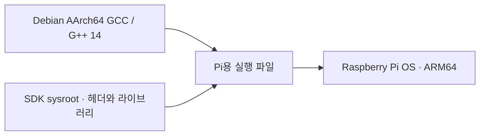

# Pi 5 크로스 빌드 SDK

**Ubuntu에서 Raspberry Pi용 실행 파일을 빌드하는 데 필요한 헤더와 라이브러리를 제공합니다.** 배포된 SDK로 바로 빌드할 수 있으며, 이 폴더에는 SDK를 다시 만드는 설정이 있습니다.



| 구성 | 사용 값 |
|---|---|
| 개발 Host | Ubuntu 24.04 |
| 실행 Target | Raspberry Pi 5 · Raspberry Pi OS Lite 64-bit |
| 아키텍처 | AArch64 / Cortex-A76 |
| 컴파일러 | Debian `aarch64-linux-gnu-gcc/g++` |
| SDK 용도 | Pi용 sysroot, C/C++ 헤더·링크 라이브러리 |
| 배포 버전 | GitHub Release `v1.2` |

## 같은 빌드 환경을 함께 사용합니다

개발 PC와 GitHub Actions가 같은 Release SDK를 사용합니다. 컴파일러가 ARM64 실행 파일을 만들고, SDK의 헤더·라이브러리가 Pi에서 실행할 모듈을 연결합니다. 빌드한 파일은 [CI/CD](../scripts/README.md)에서 검사한 뒤 차량에 배포합니다.

## 배포된 SDK 사용

저장소 루트에서 실행합니다.

```bash
./scripts/setting/download_sdk.sh
source scripts/setting/setup_sdk.sh
make -C sensor
```

`setup_sdk.sh`가 컴파일러·sysroot·pkg-config 경로를 설정하고 SQLite ARM 링크를 검사합니다. 새 터미널에서는 다시 `source`합니다. [전체 설치·빌드 안내](../scripts/README.md)

## SDK를 다시 제작할 때

**Buildroot 설정 → 라이브러리 선택 → SDK 생성 → 모듈 빌드 검증 → Release 등록** 순서입니다.

[buildroot_rpi5_toolchain_defconfig](buildroot_rpi5_toolchain_defconfig)는 CPU·C++·Binutils 등 기본 설정을 담습니다. Buildroot `2025.05.1`에서 이 설정을 불러오고 SQLite 등 모듈에 필요한 개발 라이브러리를 추가합니다.

<details>
<summary>Buildroot에서 SDK 생성</summary>

별도로 준비한 Buildroot 소스 디렉터리에서 진행합니다.

```bash
PROJECT_ROOT=/path/to/2026ESWContest_mobility_ACE
BUILDROOT_DIR=/path/to/buildroot-2025.05.1
make -C "$BUILDROOT_DIR" \
    BR2_DEFCONFIG="$PROJECT_ROOT/toolchain/buildroot_rpi5_toolchain_defconfig" defconfig
make -C "$BUILDROOT_DIR" menuconfig
```

Target과 맞는 C 라이브러리, SQLite 헤더·링크 라이브러리, 사용하는 모듈의 개발 라이브러리를 선택합니다.

```bash
make -C "$BUILDROOT_DIR" -j"$(nproc)"
make -C "$BUILDROOT_DIR" sdk
```

</details>

<details>
<summary>배포 전 검증과 Release 파일</summary>

1. 새 경로에 SDK를 풀고 `source scripts/setting/setup_sdk.sh`로 적용합니다.
2. sysroot·SQLite ARM 링크 검사를 통과한 뒤 Pi 6개 모듈을 빌드합니다.
3. Release 파일명을 `aarch64-buildroot-linux-gnu_sdk-buildroot_rpi5.tar.gz`로 맞춥니다.
4. 버전·SHA-256이 바뀌면 [CI SDK 다운로드 설정](../.github/workflows/ci.yml)도 함께 갱신합니다.

이 폴더의 제작 대상은 개발용 SDK입니다. Pi의 운영체제는 Raspberry Pi OS를 사용합니다.

</details>

[설치·CI/CD](../scripts/README.md) · [프로젝트 소개](../README.md)
